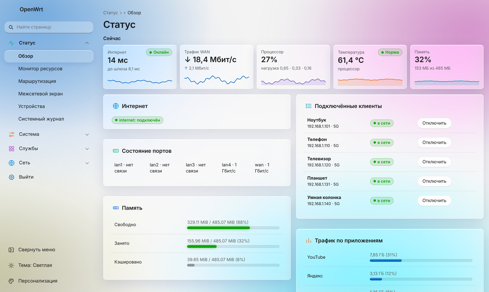
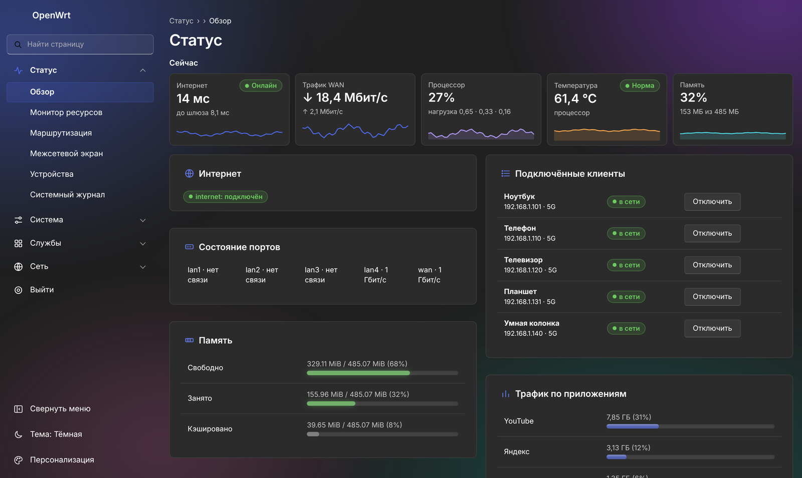
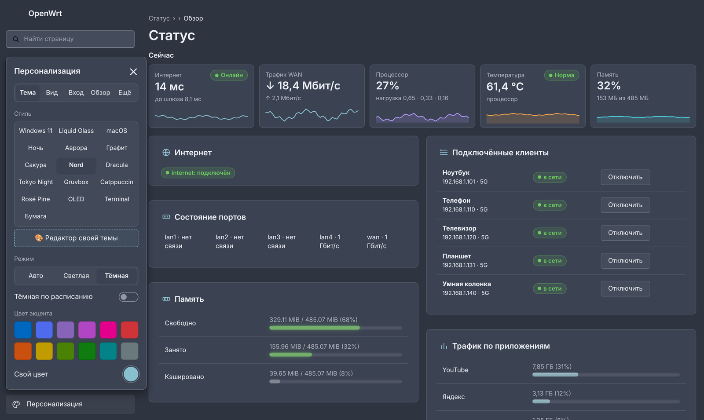
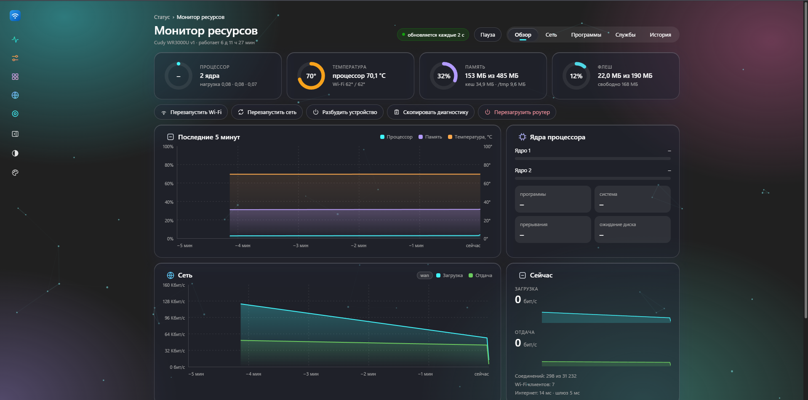
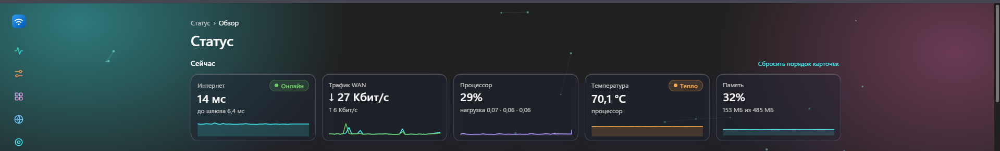
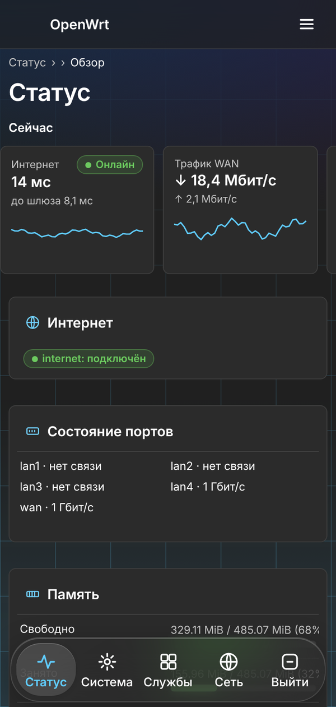
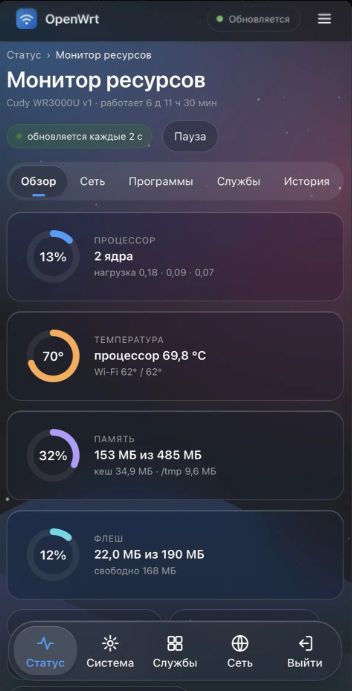
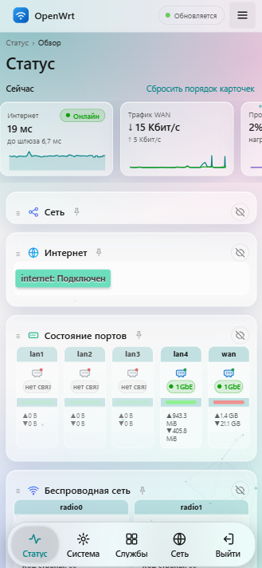

# Nightfall for OpenWrt

[Русский](README.md) | **English** | [FAQ (in Russian)](FAQ.md)

[](https://github.com/Nikolai752/nightfall-openwrt/releases)
[](https://openwrt.org)
[](https://opensource.org/licenses/MIT)

A LuCI theme in the style of Windows 11 and Liquid Glass, plus a **Resource Monitor** page with history, charts, traffic accounting by device and by application, Telegram notifications and one-click updates. For **OpenWrt 25.12**. The installer checks for `base64` and installs `coreutils-base64` if the BusyBox applet is missing; `curl` is needed only for updates and Telegram.

> **Language note.** The theme's own interface (personalization panel, Overview widgets, Resource Monitor, login screen, notifications) is currently **in Russian only**. Standard LuCI pages (Network, Firewall, etc.) are still translated by LuCI as usual. Contributions are welcome via [Issues](https://github.com/Nikolai752/nightfall-openwrt/issues).

## Screenshots

> **Demo screenshots.** The three large images at the top and the phone on the left of the bottom row were taken on a demo page with made-up data (devices, traffic and numbers are not real) to show how the theme looks. "Resource Monitor", "Overview" and the two phones on the right are from a real router.












<p align="center">
  
  
  
</p>

<p align="center"><sub>Left: demo screenshot; the two on the right are from a real router.</sub></p>

## Features

**Theme**
- Two styles: Windows 11 (Mica, cards) and Liquid Glass (translucent blurred cards).
- Light and dark modes, switching automatically by system setting or by schedule.
- 12 accent colors plus a custom color.
- **Ready-made themes** in one tap: Nord, Dracula, Tokyo Night, Gruvbox, Catppuccin, Rosé Pine, OLED, Terminal, Paper, plus Night, Aurora, Graphite and Sakura.
- **Live backgrounds:** Mica, dots, grid, stars, aurora, waves, Mesh, Particles, Neon, Sunset, Ocean, Snow, Rain, Time of day and Weather (the background follows the weather where you are; data comes from Open-Meteo or wttr.in straight from your browser, no key needed; a VPN on the device may be required in some countries). Animated "constellations".
- **Charts:** area, line, bars, steps; 10 palettes, line width, grid, load-based line colour (green, yellow, red), a running glint, smooth number counters. Memory and storage bars are coloured by level.
- Animations: smooth page changes, a pulsing "Online" dot, a ripple on buttons (all can be turned off in Personalisation).
- The Personalisation menu is split into tabs: Theme, Look, Login, Overview, More. Settings are stored on the router and follow you across browsers.
- Collapsible menu, page search (`Ctrl+K` or `/`), quick theme toggle button.
- Mobile layout: bottom section bar, settings shown as cards, a compact one-row "Apply / Save / Reset" bar that adapts to the phone screen.
- Lock-screen style login page with a router summary (shown to local-network clients only).
- Can be added to a phone home screen as an app. Appearance settings are stored on the router and survive switching browsers.
- A "System → Nightfall: all elements" page with every button, form, table and notification, to check the look quickly on phone and desktop.

**Overview**
- "Now" strip: internet, WAN traffic, CPU, temperature, memory. Tiles expand into charts for an hour, a day or a week.
- Cards: router health, Wi-Fi clients and signal level, event feed, top devices by traffic, **traffic by application**, quick actions. Cards can be dragged, pinned and hidden; on wide screens they use two columns.

**Resource Monitor** (Status → Resource Monitor)
- Tabs: Overview, Network, Wi‑Fi, Devices, Programs, Services, Diagnostics, Security, Log, History.
- **Wi‑Fi:** clients, link quality, signal by hour, channel congestion and a channel recommendation.
- **Devices:** "Internet access" (block, limits, per-day schedule, groups) and per-device traffic.
- **Calmer Overview**: a verdict line on top, details on demand, card dragging only in "View → Edit layout".
- **Memory by program over time** with possible-leak flags (Programs tab) and pinned entries in the Log.
- **Who is home** and **unusual activity** in Devices; per-hop loss, a bufferbloat test and a check history in Diagnostics; WAN address with CGNAT detection in Network.
- **Wi‑Fi extras:** 2.4/5 GHz comparison, recommendations for weak signal and frequent disconnects, a client join/leave journal.
- **Settings checks** in Security (root password, Wi‑Fi encryption, SSH password login, HTTPS for LuCI), a period picker and CSV export in Log, and a per-service log button in Services.
- **Blocking offenders:** in Security a "Close for 24 h" button next to noisy addresses (nft table `nightfall_ban`, cleared on router reboot), a list of closed addresses with an "Open" button; the bot reports bursts of failed logins in Telegram (`TG_SEC`).
- **Router log** (logread) with search and filters in the Log tab, **DNS statistics** in Network (needs `dhcp.@dnsmasq[0].logqueries=1`) and a **device card** opened by clicking a row in Devices.
- **Diagnostics:** ping, traceroute, DNS, router speed tests and a "Check everything" button (gateway, internet, DNS).
- **Security:** failed and successful SSH and LuCI logins, most frequent offenders, open router ports, port forwards, new devices, versions. Read-only: it only shows what the router already logs.
- **Log:** events, outages, reboots and blocks in one feed with search and filter.
- CPU, temperature, memory, flash storage, per-core load, memory by process.
- "Network" tab: interface speeds, connections, per-device traffic for today and yesterday, Wi-Fi clients with a signal-level chart when you tap a row.
- "History" tab: charts for 1 hour, 24 hours and 7 days, connection quality, a log of outages and reboots, alert and notification settings.
- "Services" tab: router service status with start, stop and restart. Services enabled at boot but not running are marked red. Key services (network, web server, SSH, firewall) cannot be stopped from here, so you do not lose access.
- Internet speed test run by the router itself with several streams (enough for fast links): Cloudflare, Yandex Mirror, Hetzner, OVH or a custom URL, manual and scheduled.
- Alerts even when the page is closed: overheating, low memory, full flash, sustained high load, lost internet, new devices on the network.

**Traffic by application**
- How much YouTube, Telegram, Netflix, Google, Yandex and other services downloaded: today, 7 and 30 days, in total or per device. Details below.

**Telegram notifications and bot**
- Messages about lost and restored internet, overheating, low memory, reboots and new devices; a button-driven bot (status, clients, traffic, device blocking, reboot) and a daily report. Details below.

**Look.** Windows 11, Liquid Glass and macOS styles, one-tap presets (Night, Aurora, Graphite, Sakura), a **custom theme editor** (colours, corner radius, font, shadows; share a theme as a text code NF1:…), chart styles (area, line, bars, steps, 10 palettes), line icons for devices and apps. Overview cards can be dragged and **resized by their corner**. The login screen offers time-of-day, rain, sunset, animations and **your own photo** (kept on the router in `/etc/nightfall-bg.json`).

**Devices and groups** (Status → Devices)
- Network map: the router in the middle, devices around it; dashed lines for Wi-Fi, solid for wired; a line comes alive and shows the speed while data flows. Tap a device to open its card.
- Device card: custom name, icon, group, traffic today and right now, Wi-Fi signal, internet block, schedule and daily quota.
- Groups ("Kids", "Guests", "Smart home"): rules apply to every device of a group at once: block, "from … to …" schedule, a daily quota for each. Groups can also be controlled from the bot.

**Internet access**
- A card on the Overview page and bot buttons: cut a device off the internet manually, on a schedule (for example a child's tablet from 23:00 to 07:00) or by a daily traffic quota. A block log is kept.

**Login screen**
- The three summary cards (internet, current speed, speed test, uptime, firmware, temperature, load, memory, device count) are chosen in Personalize → Login screen. You can also upload your own picture instead of the logo. The summary is shown on the local network only.

**Backup**
- The bot's Backup button creates a verified local archive and sends it to Telegram; the local copy remains on the router. Telegram secrets and OpenWrt network settings are excluded. LuCI can create an archive; you can receive it as a file and safely restore it through the Telegram bot or over SSH.
- Every 6 hours the bot checks for a new theme version and sends a notice with "Install", "Later" and "Skip this version" buttons (also the "Updates" menu button and `/update`). The install verifies sha256 and the signature and rolls back on error; admins only. Turn it off with `TG_UPDATES=0`.

**Updating from the interface**
- A "New version available" dialog, one-click install with sha256 and signature checks, rollback on error, release notes after sign-in. See "Updating".

Live data is collected in RAM (`/tmp`). To keep history across reboots, set `PERSIST_DIR` to a folder on a USB/SD drive. Nightfall then keeps detailed samples, long-term history (up to 90 days), hourly Wi-Fi signal and hourly traffic. Backups are stored in a separate `nightfall-backups` directory on the same external drive. If the drive is not mounted, history persistence pauses without writing through to the underlying `/overlay`, while backups temporarily fall back to `/tmp`.

### Lite mode for weak routers
Set `LITE` in Resource Monitor → settings. `LITE=0` (default) is the full mode: the collector samples every 15 s, per-app accounting and Wi‑Fi history are available. `LITE=1` is Lite: sampling every 60 s, no per-app accounting and no Wi‑Fi history, much lighter on CPU and RAM. The mode that is actually running is shown in the monitor header and in the "Router health" card ("Mode: Full" or "Mode: Lite"); it reflects the running collector, not just the settings file.

### Traffic by application

The "Traffic by application" card on the Overview page shows how much YouTube, Telegram, Netflix and other services downloaded (today, 7 and 30 days, in total or per device). Under "Other" you see the heaviest unrecognised domains.

It is switched on with the button in the card: the theme enables the dnsmasq DNS log (`/tmp/nightfall-dns.log`, in RAM, up to 1 MB) and conntrack counters, and the router matches connection addresses to names from DNS queries. Switching it off restores the previous dnsmasq settings. Built-in rules live in `/usr/share/nightfall/apps.list`; add your own to `/etc/nightfall-apps.list` as `Name|domains separated by spaces|IP prefixes` (checked first).

Limits: traffic through a VPN or encrypted DNS (DoH/DoT) cannot be classified, with Flow Offloading enabled the counters may be too low, and the numbers are approximate.

### Telegram notifications and bot

The monitor can message you in Telegram when the internet goes down or comes back, on overheating, low memory, a reboot, and when an unknown device appears on the network (it also lands in the event feed without Telegram). At most 30 messages per hour.

**Setup:** Resource monitor → History → Settings → "Telegram notifications".
1. Create a bot with @BotFather (`/newbot`) and paste the token.
2. Open your bot and press Start.
3. Press "Detect chat id", then "Send test".
4. Turn on "Send notifications" and save.

**Button bot** (in a private chat it responds to the configured owner, `TG_CHAT`; management actions are admin-only). Send `/menu` to show the main menu: **Status**, **Clients**, **Traffic**, **Apps**, **Speed**, **Block**, **Guest Wi-Fi**, **Wake device** (Wake-on-LAN), **Backup**, **Services**, **Reboot**, **Clear chat**, and **Updates**. The Block section also provides device groups and the block log. Service restarts and router reboot require a separate confirmation. Commands include `/menu`, `/help`, `/status`, `/clients`, `/traffic`, `/apps`, `/speed`, `/block`, `/bl` (block log), `/wake`, `/guest`, `/svc`, `/restart`, `/report`, `/update`, and `/widget`. Disable the bot with `TG_BOT=0`.

**Device blocking.** The "Block" button lists devices (🟢 online, 🔴 blocked, ⏰ has a schedule); tapping one cuts it off the internet or restores it. The "Internet access" card on the Overview page does the same and also sets a daily "from … to …" schedule (may cross midnight). Only internet forwarding is blocked, by MAC address (a separate nft table `inet nightfall`); the router and the LAN stay reachable. Phones with a random Wi-Fi address are better blocked in the phone's own settings. The list lives in `/etc/nightfall-block.list`.

**Quotas and log.** In the "Internet access" card (the ⏰ button on a device) you can set a daily traffic quota: when the device downloads more, its internet is cut until the end of the day and Telegram sends a "Restore for today" button. "Restore" also works for schedules: the rule is skipped until the end of the day. The log shows who was blocked, when and why (`/etc/nightfall-block.log`).

**New device** messages arrive in Telegram with "It's mine" and "Block" buttons.

**Groups in the bot.** The "Block" section has a "👥 Groups" button: tapping a group cuts the internet for all its devices or restores it (🟢 working, 🔴 blocked, ⏰ schedule, 📉 quota). Groups are created on the Devices page. A single device can still be restored from its card, but if the group was blocked by hand, restore the group first. Files: `/etc/nightfall-devices.list` (names, icons, groups) and `/etc/nightfall-groups.list` (group rules); both are part of the backup.

**Backup and restore.** The "Backup" button creates a verified archive, keeps a local copy on the router, and sends the archive as a separate Telegram file. Tap **"Check and restore"** below that file: the bot validates the archive and displays its contents. Only then does it show a separate **"Restore settings"** confirmation (valid for 5 minutes) and a Cancel button. On success, the bot reports the result and restarts the collector and itself. OpenWrt network settings are not included. `TG_TOKEN` and `TG_PROXY` are not stored in the archive; the current values are preserved from the router's existing configuration. Do not extract the archive manually over `/` or `/etc`. See the [backup and restore guide](docs/backup-restore.md).

**Reboot** from the bot asks for confirmation with a button.

**Daily report.** Set "Daily report, time" in the settings (for example `21:00`): at that time you get the day's traffic, top devices and applications, warnings and peak temperature. Empty = off.

Requires **curl** (`apk add curl`). If `api.telegram.org` is blocked, set a "Telegram proxy" (for example `socks5h://127.0.0.1:1080`) or a "VPN interface" (for example `wg0`) and Telegram requests will go through it. Known devices are kept in `/etc/nightfall-known.list`; phones using a random Wi-Fi address may look new. The bot token is stored in `/etc/nightfall-monitor.conf` (mode 600) and is never shown in the interface.

## Support the project

If you find the theme useful, you can buy the author a cup of tea. It is voluntary and changes nothing.

[](https://pay.cloudtips.ru/p/7e7fa6da)

## Installation

SSH access to the router is required.

**One command** (the router needs internet access):
```sh
wget -qO- https://raw.githubusercontent.com/Nikolai752/nightfall-openwrt/main/install-update.sh | sh
```
The script finds the latest version itself, downloads that release, verifies its checksum and signature and prints which version is installed at the end. If `wget` cannot do HTTPS, use `curl -fsSL URL | sh` (`apk add curl ca-bundle`).

Options go after `sh -s --`, for example `... | sh -s -- --activate`:

| Option | What it does |
| --- | --- |
| `--activate` | make Nightfall the default theme right away |
| `--check` | only show the installed and the latest version |
| `--force` | reinstall even if the version is already the latest |
| `--list` | list the latest versions to pick one |
| `--version v1.16.2` | install a specific version (older ones too) |
| `--file PATH` | install from a local archive |

**Manually, without internet on the router:** download `nightfall-root.tar.gz` from [Releases](https://github.com/Nikolai752/nightfall-openwrt/releases/latest) and `install-update.sh`, put them in one folder and run:
```sh
scp -O nightfall-root.tar.gz install-update.sh root@192.168.1.1:/tmp/
ssh root@192.168.1.1 "cd /tmp && sh install-update.sh --activate"
```
Without `--activate`, select the theme under System → System → Language and Style. Old archives left in `/tmp` are never used when installing from the internet.

After installing, log out of LuCI and log in again, then press `Ctrl+F5`. On iPhone, close the home-screen app and reopen it.

## Updating

Use the same command as for installation. Your settings are kept. If the version is already the latest, the script says so (`--force` reinstalls).

### Updating from the interface

When a new version is released, the theme shows a "New version available" dialog. Press "Update": the router downloads the release, verifies its sha256 checksum and installs it; on any error the files are restored from a backup. Since v1.0.11 releases are also signed with a usign key: the router checks the signature against `/etc/nightfall-release.pub` and refuses an archive with a bad signature. The first update to a signed version (v1.0.11) goes by sha256 and brings the public key; after that the signature is always required. See [CHANGELOG.md](CHANGELOG.md) for the history. Afterwards the session restarts. Sign in again in the same browser to see the “What’s new” dialog with entries from `CHANGELOG.md`; it is acknowledged only when you press “Got it”. A clean install does not show this dialog. If the changelog cannot be loaded, the theme retries on the next sign-in.

The router needs **curl** to download the release (`apk add curl`, or `opkg install curl` on older releases) and `usign` to verify signatures (already present in OpenWrt 25.12).

## Uninstalling

Directly on the router (over SSH), one command:
```sh
wget -qO- https://raw.githubusercontent.com/Nikolai752/nightfall-openwrt/main/uninstall.sh | sh
```
The script switches back to the default theme and removes everything: the theme, the resource monitor, the bot, the history collector, menu entries (including "Nightfall: all elements"), rpcd permissions, LuCI settings entries and caches. Your settings (`/etc/nightfall-*`) are kept so a reinstall restores everything. Options (after `sh -s --`):

- `--wipe` delete everything, including settings, device lists, the journal and the bot token;
- `--theme-only` only switch back to the default theme and leave the files.

If LuCI will not open at all: `uci set luci.main.mediaurlbase=/luci-static/bootstrap; uci commit luci`.

## Configuration

- Appearance: the "Personalization" button at the bottom left. Colors and sizes are defined at the top of `cascade.css` (`--nf-accent`, `--nf-bg`, `--nf-radius`).
- Alerts, internet check addresses and history folder: Monitor → History → "Alert settings", or the file `/etc/nightfall-monitor.conf`.
- Collector service: `/etc/init.d/nightfall-collector start|stop|restart|enable|disable`. Without it the history, traffic accounting and the Telegram bot do not work (the bot is started by the same service).
- Per-device traffic accounting requires `net.netfilter.nf_conntrack_acct=1`:
  `echo "net.netfilter.nf_conntrack_acct=1" >> /etc/sysctl.conf && sysctl -p`.
  With flow offloading enabled some traffic is not visible, so numbers may be underestimated.
- "Wake device" requires the `etherwake` package. If temperature is not shown, send the output of `ls /sys/class/thermal/*/type /sys/class/hwmon/*/name`.

## Requirements and compatibility

- **Target platform: OpenWrt 25.12 with LuCI.** The current release line has been hardware-tested on a Cudy WR3000U-256MB running OpenWrt 25.12.6. LuCI templates and menus may differ on 23.05 and 24.10; compatibility there is not confirmed. OpenWrt 21.02 and older are unsupported.
- **CPU architecture does not matter:** there are no compiled programs, only CSS, JS, templates and shell scripts.
- **Storage:** the installed theme takes about 1.4 MB. That can be a lot on routers with 4–8 MB of flash; 16 MB and more is fine. If space is tight, you can delete the iPhone splash images (`/www/luci-static/nightfall/splash`).
- **RAM:** history is kept in `/tmp`. On routers with 64 MB or less it takes a noticeable share of memory.
- **Temperature** is read from `/sys/class/thermal` and `/sys/class/hwmon`. If a model has no such sensors, temperature will not be shown; everything else works.
- **Per-device traffic accounting** requires `nf_conntrack` (see "Configuration").

## Status

**Confirmed hardware baseline:** Cudy WR3000U-256MB running OpenWrt 25.12.6. On this device, the collector and Telegram bot, notifications, device and application statistics, USB history persistence, and backup creation and restore were tested. This does not mean every third-party LuCI page or add-on package (such as adblock or sqm) was validated. Other router models and OpenWrt versions do not yet have confirmed hardware results; treat their compatibility as unverified until test reports are available.

If you installed the theme on another router, please tell us in [Issues](https://github.com/Nikolai752/nightfall-openwrt/issues) how it went: model, OpenWrt version, what works and what does not. That helps build a list of tested devices. Found a bug or want an improvement? Same place.

## Repository layout

- `luci-theme-nightfall/`: the theme (CSS, JS, templates).
- `luci-app-nightfall-monitor/`: the monitor, history collector, per-application accounting, Telegram bot, updater, menu and access rights.
- `CHANGELOG.md` — release notes (shown after an update).
- `install-update.sh` (install and update), `install.sh` (wrapper), `uninstall.sh`: install, update, uninstall.
- `build-release.sh`: builds `dist/nightfall-root.tar.gz`.

## Making a release

Releases are signed with a [usign](https://git.openwrt.org/project/usign.git) key. Create the key once on any router: `usign -G -c "Nightfall release key" -s nf.sec -p nf.pub`, put the contents of `nf.pub` into `luci-theme-nightfall/root/etc/nightfall-release.pub` and the contents of `nf.sec` into the repository secret `NIGHTFALL_SIGN_KEY` (Settings → Secrets and variables → Actions).

The theme version lives in `luci-theme-nightfall/htdocs/luci-static/nightfall/version.json` (shown on the About page); keep it equal to the top entry of `CHANGELOG.md` before a release, `tools/check.sh` verifies this. The asset cache version (`?v=…` in `header.ut`) no longer needs a manual bump: `build-release.sh` stamps the release number into it.

Then create a release with a tag like `vX.Y.Z` (on the Releases page or with `gh release create`). GitHub Actions builds `nightfall-root.tar.gz`, signs it, attaches the `.sha256` and `.sig` files and updates `latest.json`. Remember to add an entry to `CHANGELOG.md`.

The repository contains no symbolic links (`nightfall-light`, `nightfall-dark`, `prefs.json`): `build-release.sh` creates them. To build an `.apk` with the SDK, create them manually.
