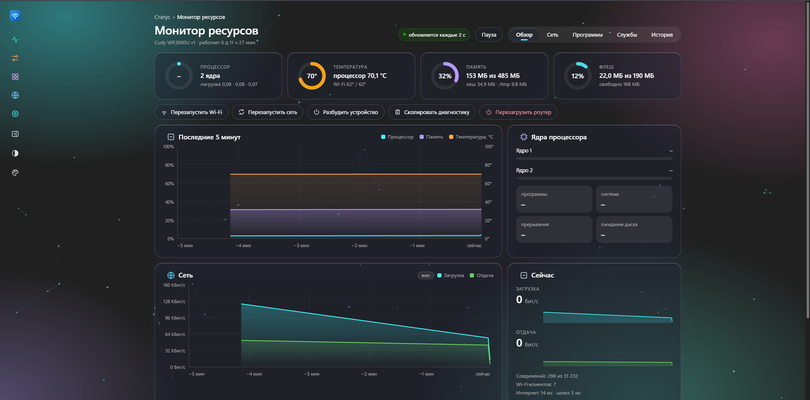
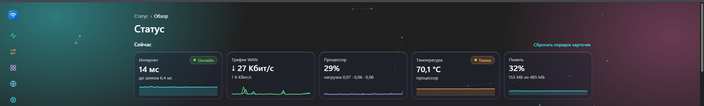
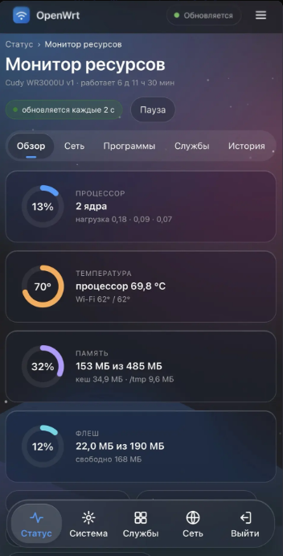
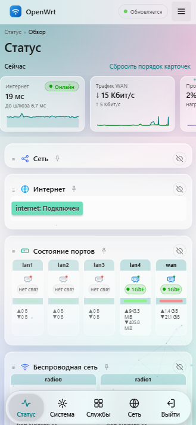

# Nightfall for OpenWrt

[Русский](README.md) | **English**

A LuCI theme in the style of Windows 11 and Liquid Glass, plus a **Resource Monitor** page with history, charts and per-device traffic accounting. For **OpenWrt 25.12**, no extra packages required.

> **Language note.** The theme's own interface (personalization panel, Overview widgets, Resource Monitor, login screen, notifications) is currently **in Russian only**. Standard LuCI pages (Network, Firewall, etc.) are still translated by LuCI as usual. Contributions are welcome; contributions are welcome via [Issues](https://github.com/Nikolai752/nightfall-openwrt/issues).

## Screenshots





<p>
  
  
</p>

## Features

**Theme**
- Two styles: Windows 11 (Mica, cards) and Liquid Glass (translucent blurred cards).
- Light and dark modes, switching automatically by system setting or by schedule.
- 12 accent colors plus a custom color, backgrounds (Mica, dots, grid, stars, aurora, waves) and animated "constellations".
- Collapsible menu, page search (`Ctrl+K` or `/`), quick theme toggle button.
- Mobile layout: bottom section bar, settings shown as cards, a "Save & Apply" bar at the bottom of the screen.
- Lock-screen style login page with a router summary (shown to local-network clients only).
- Can be added to a phone home screen as an app. Appearance settings are stored on the router and survive switching browsers.

**Overview**
- "Now" strip: internet, WAN traffic, CPU, temperature, memory. Tiles expand into charts for an hour, a day or a week.
- Router health, Wi-Fi clients and signal level, event feed, top devices by traffic, quick actions.
- Cards can be dragged, pinned and hidden.

**Resource Monitor** (Status → Resource Monitor)
- Tabs: Overview, Network, Programs, Services, History.
- CPU, temperature, memory, flash storage, per-core load, memory by process.
- "Network" tab: interface speeds, connections, per-device traffic for today and yesterday, Wi-Fi clients with a signal-level chart when you tap a row.
- "History" tab: charts for 1 hour, 24 hours and 7 days, connection quality, a log of outages and reboots.
- "Services" tab: router service status with start, stop and restart. Services enabled at boot but not running are marked red. Key services (network, web server, SSH, firewall) cannot be stopped from here, so you do not lose access.
- Internet speed test run by the router itself: Cloudflare, Yandex Mirror, Hetzner, OVH or a custom URL, manual and scheduled.
- Alerts even when the page is closed: overheating, low memory, full flash, sustained high load, lost internet.

History is kept in RAM (`/tmp`); nothing is written to flash. To keep history across reboots, point it at a folder on a USB drive or SD card.

## Support the project

If you find the theme useful, you can buy the author a cup of tea. It is voluntary and changes nothing.

[](https://pay.cloudtips.ru/p/7e7fa6da)

## Installation

SSH access to the router is required.

**One command** (the router needs internet access):
```sh
wget -qO- https://raw.githubusercontent.com/Nikolai752/nightfall-openwrt/main/install-update.sh | sh
```

**Manually:** download `nightfall-root.tar.gz` from [Releases](https://github.com/Nikolai752/nightfall-openwrt/releases/latest) and `install.sh`, put them in one folder and run:
```sh
scp -O nightfall-root.tar.gz install.sh root@192.168.1.1:/tmp/
ssh root@192.168.1.1 "cd /tmp && sh install.sh --activate"
```
`--activate` enables the theme right away. Without it, select the theme under System → System → Language and Style.

After installing, log out of LuCI and log in again, then press `Ctrl+F5`. On iPhone, close the home-screen app and reopen it.

## Updating

Use the same one-line command as for installation, or run `install-update.sh` manually. Your settings are kept.

## Uninstalling

```sh
scp -O uninstall.sh root@192.168.1.1:/tmp/
ssh root@192.168.1.1 "sh /tmp/uninstall.sh"          # switch back to the default theme
ssh root@192.168.1.1 "sh /tmp/uninstall.sh --purge"  # and delete all Nightfall files
```
If LuCI will not open at all: `uci set luci.main.mediaurlbase=/luci-static/bootstrap; uci commit luci`.

## Configuration

- Appearance: the "Personalization" button at the bottom left. Colors and sizes are defined at the top of `cascade.css` (`--nf-accent`, `--nf-bg`, `--nf-radius`).
- Alerts, internet check addresses and history folder: Monitor → History → "Alert settings", or the file `/etc/nightfall-monitor.conf`.
- Collector service: `/etc/init.d/nightfall-collector start|stop|restart|enable|disable`. Without it the history and per-device accounting stay empty.
- Per-device traffic accounting requires `net.netfilter.nf_conntrack_acct=1`:
  `echo "net.netfilter.nf_conntrack_acct=1" >> /etc/sysctl.conf && sysctl -p`.
  With flow offloading enabled some traffic is not visible, so numbers may be underestimated.
- "Wake device" requires the `etherwake` package. If temperature is not shown, send the output of `ls /sys/class/thermal/*/type /sys/class/hwmon/*/name`.

## Requirements and compatibility

- **OpenWrt 25.12 with LuCI.** The theme is written for this version. On 23.05 and 24.10 LuCI templates and menus may differ and some elements may render incorrectly. On 21.02 and older the theme will not work.
- **CPU architecture does not matter:** there are no compiled programs, only CSS, JS, templates and shell scripts.
- **Storage:** the installed theme takes about 1.4 MB. That can be a lot on routers with 4–8 MB of flash; 16 MB and more is fine. If space is tight, you can delete the iPhone splash images (`/www/luci-static/nightfall/splash`).
- **RAM:** history is kept in `/tmp`. On routers with 64 MB or less it takes a noticeable share of memory.
- **Temperature** is read from `/sys/class/thermal` and `/sys/class/hwmon`. If a model has no such sensors, temperature will not be shown; everything else works.
- **Per-device traffic accounting** requires `nf_conntrack` (see "Configuration").

## Status

Tested only on a Cudy WR3000U running OpenWrt 25.12. Not tested on other models or versions. The Software, Backup and add-on package pages (adblock, sqm, etc.) were not checked.

If you installed the theme on another router, please tell us in [Issues](https://github.com/Nikolai752/nightfall-openwrt/issues) how it went: model, OpenWrt version, what works and what does not. That helps build a list of tested devices. Found a bug or want an improvement? Same place.

## Repository layout

- `luci-theme-nightfall/`: the theme (CSS, JS, templates).
- `luci-app-nightfall-monitor/`: the monitor, history collector, menu and access rights.
- `install.sh`, `install-update.sh`, `uninstall.sh`: install, update, roll back.
- `build-release.sh`: builds `dist/nightfall-root.tar.gz`.

## Making a release

```sh
git tag v1.0.2
git push origin v1.0.2
```
GitHub Actions builds `nightfall-root.tar.gz` and attaches it to the release.

The repository contains no symbolic links (`nightfall-light`, `nightfall-dark`, `prefs.json`): `build-release.sh` creates them. To build an `.apk` with the SDK, create them manually.
