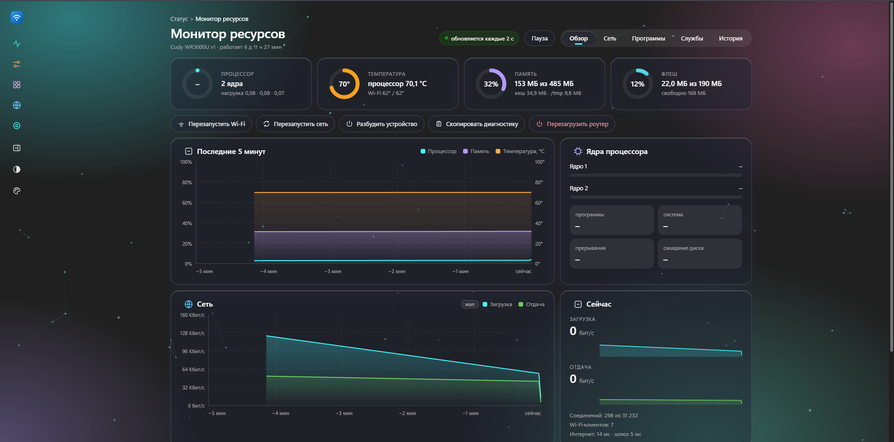
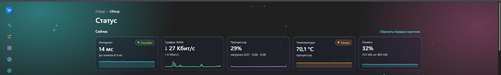
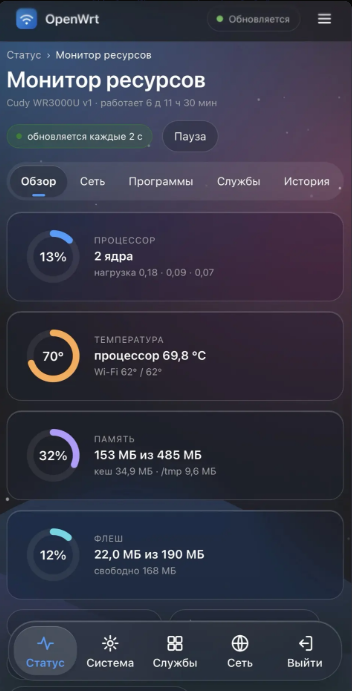

# Nightfall для OpenWrt

**Русский** | [English](README.en.md)

Тема для LuCI в стиле Windows 11 и Liquid Glass плюс страница **«Монитор ресурсов»** с историей, графиками и учётом трафика по устройствам. Для **OpenWrt 25.12**, без дополнительных пакетов.

## Скриншоты







## Возможности

**Тема**
- Два стиля: Windows 11 (Mica, карточки) и Liquid Glass (прозрачные карточки с размытием).
- Светлая и тёмная темы, автопереключение по системе или по расписанию.
- 12 акцентных цветов и свой цвет, фоны (Mica, точки, сетка, звёзды, аврора, волны), анимированные «созвездия».
- Свёртываемое меню, поиск по страницам (`Ctrl+K` или `/`), быстрая кнопка смены темы.
- Мобильный вид: нижняя панель разделов, настройки в виде карточек, панель «Сохранить и применить» внизу экрана.
- Экран входа в стиле экрана блокировки со сводкой о роутере (только для клиентов из локальной сети).
- Установка на домашний экран телефона как приложение. Настройки вида хранятся на роутере и переживают смену браузера.

**Обзор**
- Полоса «Сейчас»: интернет, трафик WAN, процессор, температура, память. Плитки раскрываются в графики за час, сутки, неделю.
- Состояние роутера, Wi-Fi клиенты и уровень сигнала, лента событий, топ устройств по трафику, быстрые действия.
- Карточки можно перетаскивать, закреплять и скрывать.

**Монитор ресурсов** (Состояние → Монитор ресурсов)
- Вкладки: Обзор, Сеть, Программы, Службы, История.
- Процессор, температура, память, флеш-память, ядра, память по программам.
- Вкладка «Сеть»: скорость интерфейсов, соединения, трафик по устройствам за сегодня и вчера, Wi-Fi клиенты с графиком уровня сигнала по нажатию на строку.
- Вкладка «История»: графики за 1 час, 24 часа, 7 дней, качество связи, журнал обрывов и перезагрузок.
- Вкладка «Службы»: состояние служб роутера, запуск, остановка и перезапуск. Службы, включённые в автозапуск, но не работающие, отмечены красным. Ключевые службы (сеть, веб-сервер, SSH, брандмауэр) отсюда остановить нельзя, чтобы не потерять доступ.
- Замер скорости интернета самим роутером: Cloudflare, Яндекс.Зеркало, Hetzner, OVH или свой адрес, ручной и автоматический запуск.
- Предупреждения даже при закрытой странице: перегрев, нехватка памяти, заполненная флеш-память, высокая нагрузка, пропажа интернета.

История хранится в оперативной памяти (`/tmp`), на флеш-память ничего не пишется. Чтобы история переживала перезагрузку, укажите папку на USB или SD-карте.

## Поддержать проект

Если тема пригодилась, можно угостить автора чаем. Это добровольно и ни на что не влияет.

[](https://pay.cloudtips.ru/p/7e7fa6da)

## Установка

Нужен SSH-доступ к роутеру.

**Одной командой** (роутеру нужен доступ в интернет):
```sh
wget -qO- https://raw.githubusercontent.com/Nikolai752/nightfall-openwrt/main/install-update.sh | sh
```

**Вручную:** скачайте `nightfall-root.tar.gz` из [Releases](https://github.com/Nikolai752/nightfall-openwrt/releases/latest) и `install.sh`, положите рядом и выполните:
```sh
scp -O nightfall-root.tar.gz install.sh root@192.168.1.1:/tmp/
ssh root@192.168.1.1 "cd /tmp && sh install.sh --activate"
```
`--activate` сразу включает тему. Без него выберите её в System → System → Language and Style.

После установки выйдите из LuCI и войдите снова, затем нажмите `Ctrl+F5`. На iPhone закройте приложение с экрана «Домой» и откройте заново.

## Обновление

Та же команда, что и для установки одной командой, либо `install-update.sh` вручную. Настройки сохраняются.

## Удаление

```sh
scp -O uninstall.sh root@192.168.1.1:/tmp/
ssh root@192.168.1.1 "sh /tmp/uninstall.sh"          # вернуть стандартную тему
ssh root@192.168.1.1 "sh /tmp/uninstall.sh --purge"  # и удалить все файлы Nightfall
```
Если LuCI не открывается совсем: `uci set luci.main.mediaurlbase=/luci-static/bootstrap; uci commit luci`.

## Настройка

- Вид темы: кнопка «Персонализация» слева внизу. Цвета и размеры в начале `cascade.css` (`--nf-accent`, `--nf-bg`, `--nf-radius`).
- Предупреждения, адреса проверки интернета, папка истории: Монитор → История → «Настройки предупреждений» или файл `/etc/nightfall-monitor.conf`.
- Служба сборщика: `/etc/init.d/nightfall-collector start|stop|restart|enable|disable`. Без неё история и учёт по устройствам пустые.
- Учёт трафика по устройствам требует `net.netfilter.nf_conntrack_acct=1`:
  `echo "net.netfilter.nf_conntrack_acct=1" >> /etc/sysctl.conf && sysctl -p`.
  При включённом flow offloading часть трафика не видна, цифры могут быть занижены.
- «Разбудить устройство» требует пакет `etherwake`. Если температура не показывается, пришлите вывод `ls /sys/class/thermal/*/type /sys/class/hwmon/*/name`.

## Требования и совместимость

- **OpenWrt 25.12 с LuCI.** Тема написана под эту версию. На 23.05 и 24.10 шаблоны и меню LuCI могут отличаться, и часть элементов отобразится неверно. На 21.02 и старше тема не заработает.
- **Архитектура процессора не важна:** в теме нет скомпилированных программ, только CSS, JS, шаблоны и shell-скрипты.
- **Место:** после установки тема занимает около 1,4 МБ. На роутерах с 4–8 МБ флеш-памяти это может быть много; на 16 МБ и больше проблем не будет. Если места мало, можно удалить заставки для iPhone (`/www/luci-static/nightfall/splash`).
- **Оперативная память:** история хранится в `/tmp`. На роутерах с 64 МБ и меньше она заметно занимает память.
- **Температура** берётся из `/sys/class/thermal` и `/sys/class/hwmon`. Если у модели нет таких датчиков, температура не покажется, остальное работает.
- **Учёт трафика по устройствам** требует `nf_conntrack` (см. «Настройка»).

## Статус

Проверялось только на Cudy WR3000U с OpenWrt 25.12. На других моделях и версиях не тестировалось. Не проверялись страницы Software, Backup и дополнительных пакетов (adblock, sqm и т. п.).

Если вы установили тему на другом роутере, расскажите в [Issues](https://github.com/Nikolai752/nightfall-openwrt/issues), как получилось: модель, версия OpenWrt, что работает и что нет. Так список проверенных устройств будет расти. Нашли ошибку или хотите улучшение, туда же.

## Структура репозитория

- `luci-theme-nightfall/` — тема: CSS, JS, шаблоны.
- `luci-app-nightfall-monitor/` — монитор, сборщик истории, меню, права доступа.
- `install.sh`, `install-update.sh`, `uninstall.sh` — установка, обновление, откат.
- `build-release.sh` — собирает `dist/nightfall-root.tar.gz`.

## Выпуск версии

```sh
git tag v1.0.2
git push origin v1.0.2
```
GitHub Actions соберёт `nightfall-root.tar.gz` и приложит к релизу.

В репозитории нет символических ссылок (`nightfall-light`, `nightfall-dark`, `prefs.json`): их создаёт `build-release.sh`. Для сборки `.apk` через SDK создайте их вручную.
