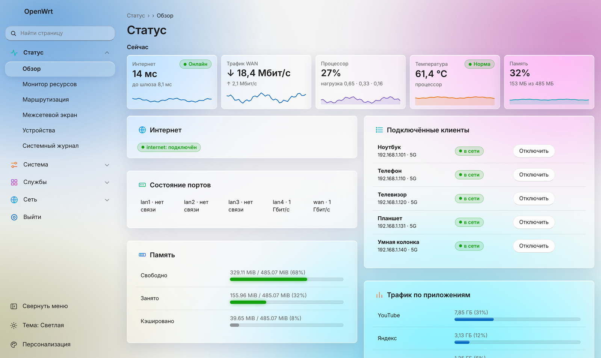
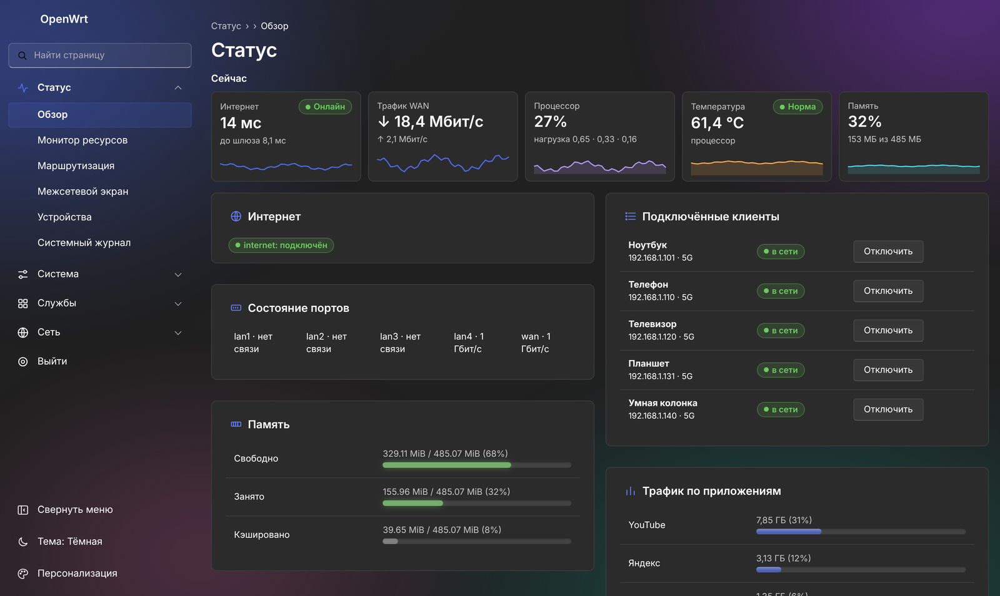
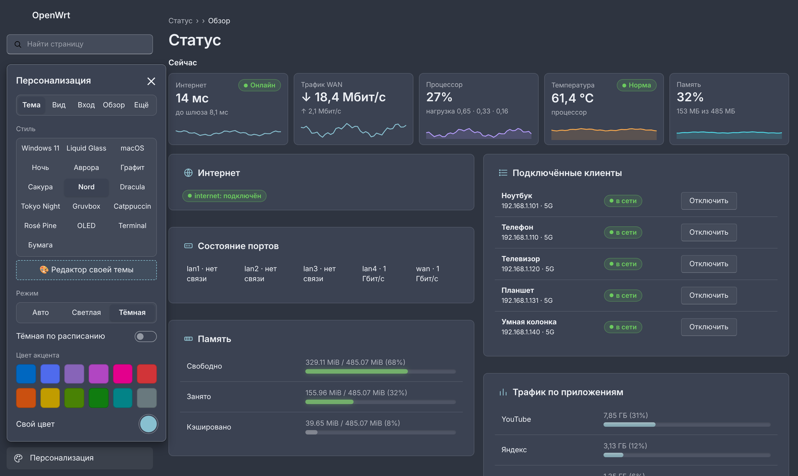
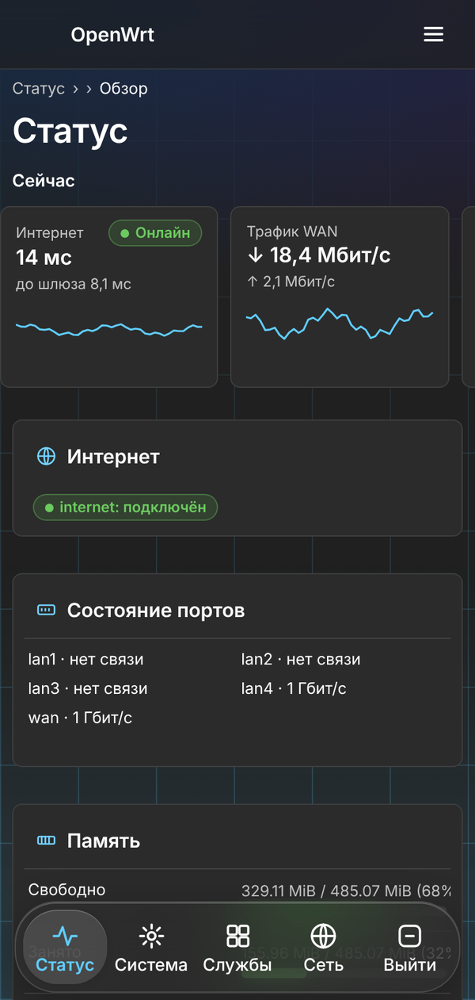
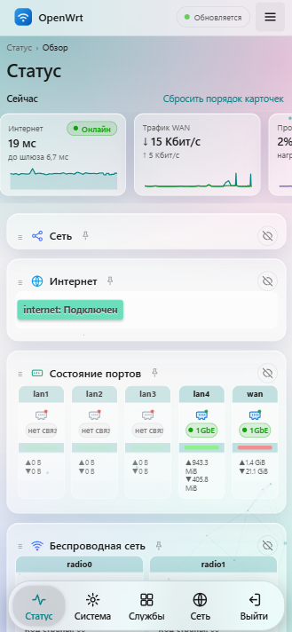

# Nightfall для OpenWrt

**Русский** | [English](README.en.md) | [FAQ: частые проблемы](FAQ.md)

[](https://github.com/Nikolai752/nightfall-openwrt/releases)
[](https://openwrt.org)
[](https://opensource.org/licenses/MIT)

Тема для LuCI в стиле Windows 11 и Liquid Glass плюс страница **«Монитор ресурсов»** с историей, графиками, учётом трафика по устройствам и приложениям, уведомлениями в Telegram и обновлением в один клик. Для **OpenWrt 25.12**, без дополнительных пакетов (`curl` нужен только для обновления и Telegram).

## Скриншоты

> **Тестовые снимки.** Три больших снимка вверху и телефон слева в нижнем ряду собраны на демонстрационной странице с выдуманными данными (устройства, трафик и цифры не настоящие), чтобы показать вид темы. Снимки «Монитор ресурсов», «Обзор» и два телефона справа сделаны на реальном роутере.








<p align="center">
  
  
  
</p>

<p align="center"><sub>Слева тестовый снимок, два справа с реального роутера.</sub></p>

## Возможности

**Тема**
- Два стиля: Windows 11 (Mica, карточки) и Liquid Glass (прозрачные карточки с размытием).
- Светлая и тёмная темы, автопереключение по системе или по расписанию.
- 12 акцентных цветов и свой цвет.
- **Готовые темы** в одно нажатие: Nord, Dracula, Tokyo Night, Gruvbox, Catppuccin, Rosé Pine, OLED, Terminal, Бумага, а также Ночь, Аврора, Графит, Сакура.
- **Живые фоны:** Mica, точки, сетка, звёзды, аврора, волны, «Перелив», «Частицы», «Неон», «Закат», «Океан», «Снег», «Дождь», «Время суток» и «Погода» (фон по погоде у вас; данные из Open-Meteo или wttr.in, прямо в браузере, ключ не нужен; в России может понадобиться VPN на устройстве). Анимированные «созвездия».
- **Графики:** заливка, линия, столбики, ступени; 10 палитр, толщина линии, сетка, цвет линии по нагрузке (зелёный, жёлтый, красный), бегущий блик, плавное «докручивание» чисел. Полосы заполнения памяти и хранилища окрашены по уровню.
- Анимации: плавная смена страниц, пульсирующая точка «Онлайн», волна на кнопках (всё отключается в «Персонализации»).
- Меню «Персонализация» разбито на вкладки: Тема, Вид, Вход, Обзор, Ещё. Настройки сохраняются на роутере и подтягиваются в других браузерах.
- Свёртываемое меню, поиск по страницам (`Ctrl+K` или `/`), быстрая кнопка смены темы.
- Мобильный вид: нижняя панель разделов, настройки в виде карточек, компактная панель «Применить / Сохранить / Сброс» в одну строку (размеры подстраиваются под экран телефона).
- Экран входа в стиле экрана блокировки со сводкой о роутере (только для клиентов из локальной сети).
- Установка на домашний экран телефона как приложение. Настройки вида хранятся на роутере и переживают смену браузера.
- Страница «Система → Nightfall: все элементы»: все кнопки, формы, таблицы и уведомления в одном месте, чтобы быстро проверить вид темы на телефоне и компьютере.

**Обзор**
- Полоса «Сейчас»: интернет, трафик WAN, процессор, температура, память, а по желанию соединения, аптайм и число Wi-Fi клиентов. Плитки раскрываются в графики за час, сутки, неделю, месяц и 3 месяца. Числа плавно «докручиваются» при обновлении.
- **Раскладки одной кнопкой:** «Стандарт» (интернет, трафик, процессор, температура, память; включена по умолчанию), «Дом» (интернет, трафик, трафик за сутки, клиенты, аптайм, температура), «Минимал» (интернет, трафик, процессор в два столбца) и «Админ» (12 плиток двумя ровными рядами).
- Плитки: интернет, трафик WAN, процессор, температура, память, соединения, аптайм, Wi-Fi клиенты, потери пакетов, сигнал Wi-Fi, трафик за сутки, хранилище. Каждая открывается по нажатию: график за час, сутки, неделю, месяц и 3 месяца либо подробности (перезагрузки, клиенты Wi-Fi, итоги по дням, флеш-память). Какие плитки показывать и в каком порядке, выбирается в «Персонализации → Обзор».
- Карточки: состояние роутера, Wi-Fi клиенты и уровень сигнала, лента событий, топ устройств по трафику, **трафик по приложениям**, быстрые действия. В «Топе клиентов» у каждой строки мини-график (скорость за последние минуты или трафик по часам за сутки), значок вида устройства и производитель. Карточки можно перетаскивать, закреплять, скрывать; на широких экранах они идут в две колонки.

**Монитор ресурсов** (Состояние → Монитор ресурсов)
- Вкладки: Обзор, Сеть, Программы, Службы, История.
- Процессор, температура, память, флеш-память, ядра, память по программам.
- Вкладка «Сеть»: скорость интерфейсов, соединения, трафик по устройствам за сегодня и вчера, Wi-Fi клиенты с графиком уровня сигнала по нажатию на строку.
- **Опознавание устройств по MAC:** адрес сопоставляется с таблицей соседей роутера (так находятся устройства без имени в DHCP и с временными адресами IPv6). Для устройства без имени показывается вид (телефон, ТВ, компьютер…) и производитель по первым трём байтам MAC из встроенной таблицы частых производителей. У телефонов с «частным адресом Wi-Fi» MAC случайный: по нему производителя узнать нельзя, и это честно помечено «частный MAC».
- Вкладка «История»: графики за 1 час, 24 часа, 7, 30 и 90 дней, качество связи, журнал обрывов и перезагрузок, настройки предупреждений и уведомлений.
- **Длинная история:** кроме подробных рядов (7 суток) сборщик ведёт ряд с шагом 30 минут на 7–90 суток (настройка «Длинная история», по умолчанию 30). Он занимает около 300 КБ на 90 суток и переживает перезагрузку, если подключена флешка. На его основе «Сравнение периодов» показывает ещё и качество связи: средний пинг, потери, пик загрузки, процессор и температуру.
- **Сигнал Wi-Fi по часам:** тепловая карта «клиент × час» (24 часа или 7 дней) с цветом по среднему сигналу: сразу видно, у кого связь плохая всегда, а у кого только в определённые часы.
- **Wi-Fi: загруженность каналов:** по кнопке роутер сканирует эфир, показывает соседние сети, нагрузку на каждом канале и подсказывает свободный (на 2,4 ГГц советуются 1, 6 и 11, на 5 ГГц каналы без DFS). Сканирование на несколько секунд отвлекает радиомодуль, поэтому по кнопке, а не постоянно.
- Вкладка «Службы»: состояние служб роутера, запуск, остановка и перезапуск. Службы, включённые в автозапуск, но не работающие, отмечены красным. Ключевые службы (сеть, веб-сервер, SSH, брандмауэр) отсюда остановить нельзя, чтобы не потерять доступ.
- Замер скорости интернета самим роутером в несколько потоков (хватает для быстрых каналов): Cloudflare, Яндекс.Зеркало, Hetzner, OVH или свой адрес, ручной и автоматический запуск.
- Предупреждения даже при закрытой странице: перегрев, нехватка памяти, заполненная флеш-память, высокая нагрузка, пропажа интернета, новые устройства в сети.

**Трафик по дням**
- Монитор → История → «Трафик по месяцам»: календарь суточных итогов WAN, лимит и прогноз. Нажмите на день: отчёт, какое устройство сколько скачало и отдало (итоги по устройствам хранятся до 90 суток). Итог за день берётся по счётчикам порта WAN, а если роутер использует аппаратное ускорение пакетов (MediaTek, Qualcomm и др.), порт видит лишь часть трафика, и тема автоматически берёт сумму по устройствам (без трафика самого роутера); такие дни помечены.

**Трафик по приложениям**
- Сравнение недели и месяца с прошлыми и выгрузка трафика, приложений, графиков и журнала в CSV (Монитор → История).
- Сколько скачали YouTube, Telegram, Netflix, Google, Яндекс и другие сервисы: сегодня, 7 и 30 дней, всего или по устройствам. Подробности в разделе ниже.

**Уведомления и бот в Telegram**
- Сообщения о пропаже и возвращении интернета, перегреве, нехватке памяти, перезагрузке и новых устройствах; бот с кнопками (статус, клиенты, трафик, блокировка устройств, включение по сети, перезагрузка) и ежедневный отчёт. Подробности в разделе ниже.

**Оформление.** Стили Windows 11, Liquid Glass и macOS, наборы оформления в одну кнопку (Ночь, Аврора, Графит, Сакура), **редактор своей темы** (цвета, скругление, шрифт, тени; тему можно отправить текстовым кодом NF1:…), стили графиков (заливка, линия, столбики, ступени, 10 палитр), линейные значки устройств и приложений. Карточки «Обзора» можно перетаскивать и **растягивать за уголок**. На экране входа: фон по времени суток, дождь, закат, анимации и **своё фото** (сохраняется на роутере в `/etc/nightfall-bg.json`).

**Устройства и группы** (Состояние → Устройства)
- Карта сети: роутер в центре, вокруг устройства; линии пунктиром для Wi-Fi, сплошные для кабеля, при передаче данных линия оживает и показывает скорость. Нажмите на устройство, чтобы открыть его карточку.
- Карточка устройства: своё имя, значок, группа, трафик за сегодня и сейчас, сигнал Wi-Fi, отключение интернета, расписание и суточный лимит.
- Группы («Дети», «Гости», «Умный дом»): правила действуют на все устройства группы сразу: отключить, расписание «с … до …», суточный лимит каждому. Группами можно управлять и из бота.

**Доступ в интернет**
- Карточка на странице «Обзор» и кнопки в боте: отключить интернет устройству вручную, по расписанию (например, ребёнку с 23:00 до 07:00) или по суточному лимиту трафика. Есть журнал блокировок.
- Вкладки «Все / В сети / Не в сети / С правилами» и по группам, поиск, кнопка «Проверить сейчас». «В сети» определяется надёжно: Wi-Fi по подключению к точке доступа, кабельные устройства по ответу на ARP-запрос (запись в таблице ARP у простаивающих телефонов пропадает, поэтому по ней одной судить нельзя).

**Экран входа**
- Три карточки со сводкой (интернет, скорость сейчас, замер, время работы, прошивка, температура, нагрузка, память, число устройств) выбираются в «Персонализации → Экран входа». Там же можно загрузить свою картинку вместо логотипа. Сводка показывается только в локальной сети.

**Резервная копия**
- Кнопка в боте и в настройках монитора присылает в Telegram архив настроек Nightfall (без токена бота).

**Обновление из интерфейса**
- Окно «Доступна новая версия», установка в один клик с проверкой sha256 и подписи, откат при ошибке, список изменений после входа. Подробности в разделе «Обновление».

История хранится в оперативной памяти (`/tmp`), на флеш-память ничего не пишется (исключение: журнал обрывов, список известных устройств и ключи). Чтобы история переживала перезагрузку, укажите папку на USB или SD-карте: тогда сохраняются и подробные ряды, и длинная история (до 90 суток), почасовой сигнал Wi-Fi и трафик по часам.

### Трафик по приложениям

Карточка «Трафик по приложениям» на странице «Обзор» показывает, сколько скачали YouTube, Telegram, Netflix и другие сервисы (сегодня, 7 и 30 дней, всего или по устройствам). Под строкой «Прочее» видно самые тяжёлые неопознанные домены.

Включается кнопкой в самой карточке: тема включает журнал DNS в dnsmasq (файл `/tmp/nightfall-dns.log` в памяти, до 1 МБ) и счётчики conntrack. Роутер сопоставляет адреса соединений с именами из DNS-запросов. Выключение возвращает прежние настройки dnsmasq. Встроенные правила лежат в `/usr/share/nightfall/apps.list`; свои добавляйте в `/etc/nightfall-apps.list` в формате `Название|домены через пробел|префиксы IP` (они проверяются первыми).

Ограничения: трафик через VPN и шифрованный DNS (DoH/DoT) определить нельзя, при включённом Flow Offloading счётчики могут занижаться, а точность приблизительная.

### Уведомления и бот в Telegram

Монитор может писать вам в Telegram: пропал или вернулся интернет, перегрев, мало памяти, перезагрузка, а также появление незнакомого устройства в сети (оно же попадает в ленту событий даже без Telegram). Не больше 30 сообщений в час.

**Настройка:** «Монитор ресурсов» → История → Настройки → «Уведомления в Telegram».
1. В Telegram создайте бота у @BotFather (`/newbot`) и вставьте токен.
2. Откройте своего бота и нажмите Start.
3. Нажмите «Определить chat id», затем «Отправить проверку».
4. Включите «Отправлять уведомления» и сохраните.

**Бот с кнопками** (отвечает только владельцу, то есть вашему chat id). Напишите боту `/menu`: под сообщением появятся кнопки Статус, Клиенты, Трафик, Приложения, Скорость, Блокировка и Перезагрузка. Команды `/status`, `/clients`, `/traffic`, `/apps`, `/speed`, `/block`, `/reboot`, `/report` тоже работают. Отключается параметром `TG_BOT=0`.

**Блокировка устройств.** Кнопка «Блокировка» показывает устройства (🟢 в сети, 🔴 отключено, ⏰ есть расписание): нажатие отключает или возвращает интернет. То же и расписание «с … до …» (можно через полночь) задаются в карточке «Доступ в интернет» на странице «Обзор». Отключается только выход в интернет по MAC-адресу (отдельная таблица nft `inet nightfall`), роутер и локальная сеть остаются доступны. Телефоны со случайным Wi-Fi адресом лучше отключать в настройках самого телефона. Список хранится в `/etc/nightfall-block.list`.

**Лимиты и журнал.** В карточке «Доступ в интернет» (кнопка ⏰ у устройства) можно задать лимит трафика в сутки: когда устройство скачает больше, интернет отключится до конца суток, а в Telegram придёт кнопка «Вернуть на сегодня». «Вернуть» работает и для расписания: правило пропускается до конца суток. Журнал: кто, когда и почему отключён (`/etc/nightfall-block.log`).

**Новое устройство** приходит в Telegram с кнопками «Это моё» и «Заблокировать».

**Группы в боте.** В разделе «Блокировка» кнопка «👥 Группы»: нажатие отключает или возвращает интернет всей группе (🟢 работает, 🔴 отключена, ⏰ расписание, 📉 лимит). Группы создаются на странице «Устройства». Своё устройство из группы можно вернуть и по отдельности («Вернуть» в карточке), а если группа отключена вручную, сначала верните группу. Файлы: `/etc/nightfall-devices.list` (имена, значки, группы) и `/etc/nightfall-groups.list` (правила групп), оба входят в резервную копию.

**Резервная копия.** Кнопка «Резервная копия» присылает файл с настройками (`tar -xzf файл -C /` для восстановления; токен бота в архив не входит, укажите его заново).

**Чистый чат.** Бот убирает за собой: ваша команда и прошлые ответы удаляются, новый ответ всегда внизу и виден сразу (в личном чате; отключается настройкой «Бот убирает за собой»). Кнопка «🧹 Очистить чат» удаляет ответы бота и ваши команды. Предупреждения роутера и резервные копии остаются.

**Живой «Статус» (пробная версия).** Если включить «Живые виджеты в боте» (`TG_WIDGETS`), «📊 Статус» приходит интерактивным сообщением (Telegram Bot API 10.4): кольца процессора, памяти и ПЗУ, температура, пинг и скорость обновляются сами, пока сообщение на экране. Работает только в личном чате; на старых клиентах и в группах приходит обычный текст.

**Замер скорости, гостевой Wi-Fi, службы.** «⚡ Скорость → Замерить сейчас» запускает замер и показывает результат в том же сообщении. «📶 Гостевой Wi-Fi» включает гостевую сеть на 1 час, 4 часа или сутки (нужна отдельная сеть Wi-Fi с «guest» или «гост» в названии или выключенная сеть). «🔁 Службы» перезапускает Wi-Fi, DHCP и DNS, брандмауэр или сеть.

**Перезагрузка** и перезапуск служб из бота требуют подтверждения кнопкой (действует минуту).

**Бот в группе.** Если в «Chat id» указана группа (id начинается с «-»), управлять ботом (блокировка, группы, включение по сети, резервная копия, перезагрузка) могут только люди из «Кому управлять ботом в группе» (`TG_USERS`, id через запятую); остальным участникам доступен просмотр. Если написать боту, не будучи в списке, он ответит вашим id.

**Ежедневный отчёт.** В настройках укажите «Ежедневный отчёт, время» (например `21:00`): в это время придёт трафик за сутки, топ устройств и приложений, предупреждения и максимум температуры. Пусто = выключен.

Нужен **curl** (`apk add curl`). Если `api.telegram.org` у вас закрыт, укажите «Прокси для Telegram» (например `socks5h://127.0.0.1:1080`) или «Интерфейс VPN» (например `wg0`): запросы к Telegram пойдут через них. Известные устройства хранятся в `/etc/nightfall-known.list`; телефоны со случайным Wi-Fi адресом могут считаться новыми. Токен бота хранится в `/etc/nightfall-monitor.conf` (права 600) и не отображается в интерфейсе.

## Поддержать проект

Если тема пригодилась, можно угостить автора чаем. Это добровольно и ни на что не влияет.

[](https://pay.cloudtips.ru/p/7e7fa6da)

## Установка

Нужен SSH-доступ к роутеру.

**Одной командой** (роутеру нужен доступ в интернет):
```sh
wget -qO- https://raw.githubusercontent.com/Nikolai752/nightfall-openwrt/main/install-update.sh | sh
```
Скрипт сам узнаёт последнюю версию, скачивает её архив, проверяет контрольную сумму и подпись и в конце пишет, какая версия установлена. Если `wget` не справляется с HTTPS, используйте `curl -fsSL URL | sh` (`apk add curl ca-bundle`).

Параметры добавляются после `sh -s --`, например `... | sh -s -- --activate`:

| Параметр | Что делает |
| --- | --- |
| `--activate` | сразу выбрать Nightfall темой по умолчанию |
| `--check` | только показать установленную и последнюю версию |
| `--force` | переустановить, даже если версия уже последняя |
| `--version v1.16.2` | поставить конкретную версию (можно и более старую) |
| `--file ПУТЬ` | поставить из локального архива |

**Вручную, без интернета на роутере:** скачайте `nightfall-root.tar.gz` из [Releases](https://github.com/Nikolai752/nightfall-openwrt/releases/latest) и `install-update.sh`, положите рядом и выполните:
```sh
scp -O nightfall-root.tar.gz install-update.sh root@192.168.1.1:/tmp/
ssh root@192.168.1.1 "cd /tmp && sh install-update.sh --activate"
```
Без `--activate` выберите тему в System → System → Language and Style. Старые архивы, случайно оставшиеся в `/tmp`, при установке «из интернета» не используются.

После установки выйдите из LuCI и войдите снова, затем нажмите `Ctrl+F5`. На iPhone закройте приложение с экрана «Домой» и откройте заново.

## Обновление

Та же команда, что и для установки. Настройки сохраняются. Если версия уже последняя, скрипт сообщит об этом (`--force` переустановит).

### Обновление из интерфейса

Когда выходит новая версия, тема показывает окно «Доступна новая версия». Нажмите «Обновить»: роутер сам скачает релиз, проверит контрольную сумму sha256 и установит его; при ошибке файлы вернутся из копии. Начиная с v1.0.11 релиз ещё и подписан ключом usign: роутер проверяет подпись открытым ключом `/etc/nightfall-release.pub` и не ставит архив с неверной подписью. После установки сессия перезапустится, а после входа появится список изменений из `CHANGELOG.md`.

Для скачивания на роутере нужен **curl** (`apk add curl`; на старых версиях `opkg install curl`), для проверки подписи нужен `usign` (в OpenWrt 25.12 он уже есть). Историю изменений смотрите в [CHANGELOG.md](CHANGELOG.md).

Первое обновление до версии с подписью (v1.0.11) устанавливается по sha256 и привозит открытый ключ; дальше подпись проверяется всегда. Если релиз без подписи или подпись неверна, обновление останавливается.

## Удаление

Прямо на роутере (по SSH), одной командой:
```sh
wget -qO- https://raw.githubusercontent.com/Nikolai752/nightfall-openwrt/main/uninstall.sh | sh
```
Скрипт возвращает стандартную тему и убирает всё: тему, «Монитор ресурсов», бота, сборщик истории, пункты меню (в том числе «Nightfall: все элементы»), права rpcd, записи в настройках LuCI и кэш. Ваши настройки (`/etc/nightfall-*`) остаются, чтобы при повторной установке всё вернулось. Параметры (после `sh -s --`):

- `--wipe` удалить вообще всё, включая настройки, списки устройств, журнал и токен бота;
- `--theme-only` только вернуть стандартную тему, файлы не трогать.

Если LuCI не открывается совсем: `uci set luci.main.mediaurlbase=/luci-static/bootstrap; uci commit luci`.

## Настройка

- Вид темы: кнопка «Персонализация» слева внизу. Цвета и размеры в начале `cascade.css` (`--nf-accent`, `--nf-bg`, `--nf-radius`).
- Предупреждения, адреса проверки интернета, папка истории: Монитор → История → «Настройки предупреждений» или файл `/etc/nightfall-monitor.conf`.
- Служба сборщика: `/etc/init.d/nightfall-collector start|stop|restart|enable|disable`. Без неё история, учёт трафика и бот Telegram не работают (бот запускается этой же службой).
- Учёт трафика по устройствам требует `net.netfilter.nf_conntrack_acct=1`:
  `echo "net.netfilter.nf_conntrack_acct=1" >> /etc/sysctl.conf && sysctl -p`.
  При включённом flow offloading часть трафика не видна, цифры могут быть занижены.
- «Разбудить устройство» требует пакет `etherwake`. Если температура не показывается, пришлите вывод `ls /sys/class/thermal/*/type /sys/class/hwmon/*/name`.

## Требования и совместимость

- **OpenWrt 25.12 с LuCI.** Тема написана под эту версию. На 23.05 и 24.10 шаблоны и меню LuCI могут отличаться, и часть элементов отобразится неверно. На 21.02 и старше тема не заработает.
- **Архитектура процессора не важна:** в теме нет скомпилированных программ, только CSS, JS, шаблоны и shell-скрипты.
- **Место:** после установки тема занимает около 1,4 МБ. На роутерах с 4–8 МБ флеш-памяти это может быть много; на 16 МБ и больше проблем не будет. Если места мало, можно удалить заставки для iPhone (`/www/luci-static/nightfall/splash`).
- **Оперативная память:** история хранится в `/tmp`. На роутерах с 64 МБ и меньше она заметно занимает память.
- **Температура** берётся из `/sys/class/thermal` и `/sys/class/hwmon`. Если у модели нет таких датчиков, температура не покажется, остальное работает.
- **Учёт трафика по устройствам и приложениям** требует `nf_conntrack` (см. «Настройка»).
- **Для обновления из интерфейса и Telegram** нужен `curl`, для проверки подписи `usign`.

## Статус

Проверялось только на Cudy WR3000U с OpenWrt 25.12. На других моделях и версиях не тестировалось. Не проверялись страницы Software, Backup и дополнительных пакетов (adblock, sqm и т. п.).

Если вы установили тему на другом роутере, расскажите в [Issues](https://github.com/Nikolai752/nightfall-openwrt/issues), как получилось: модель, версия OpenWrt, что работает и что нет. Так список проверенных устройств будет расти. Нашли ошибку или хотите улучшение, туда же.

## Структура репозитория

- `luci-theme-nightfall/` — тема: CSS, JS, шаблоны.
- `luci-app-nightfall-monitor/` — монитор, сборщик истории, учёт по приложениям, бот Telegram, обновление, меню, права доступа.
- `CHANGELOG.md` — история изменений (показывается после обновления).
- `install-update.sh` (установка и обновление), `install.sh` (обёртка), `uninstall.sh` — установка, обновление, удаление.
- `build-release.sh` — собирает `dist/nightfall-root.tar.gz`.

## Выпуск версии

Релиз подписывается ключом [usign](https://git.openwrt.org/project/usign.git). Один раз создайте ключ на любом роутере: `usign -G -c "Nightfall release key" -s nf.sec -p nf.pub`, положите содержимое `nf.pub` в `luci-theme-nightfall/root/etc/nightfall-release.pub`, а содержимое `nf.sec` в секрет репозитория `NIGHTFALL_SIGN_KEY` (Settings → Secrets and variables → Actions).

Затем создайте релиз с тегом вида `v1.0.19` (на странице Releases или командой `gh release create`). GitHub Actions соберёт `nightfall-root.tar.gz`, подпишет его и приложит `.sha256` и `.sig`, а также обновит `latest.json`. Не забудьте добавить запись в `CHANGELOG.md`.

В репозитории нет символических ссылок (`nightfall-light`, `nightfall-dark`, `prefs.json`): их создаёт `build-release.sh`. Для сборки `.apk` через SDK создайте их вручную.
