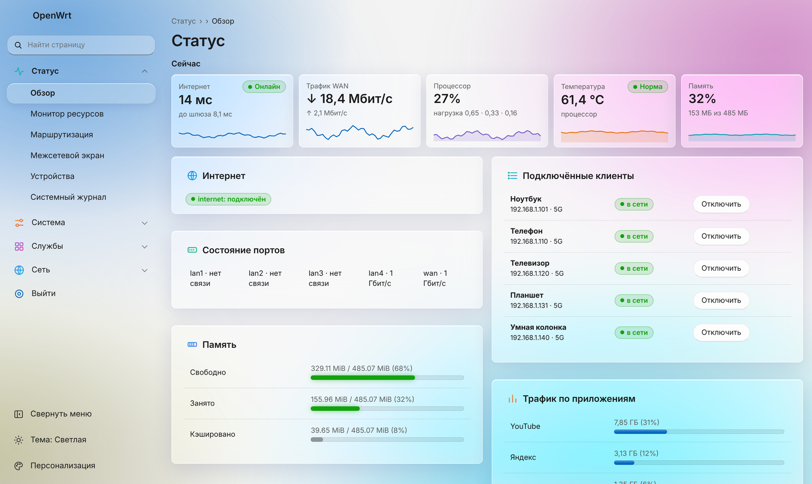
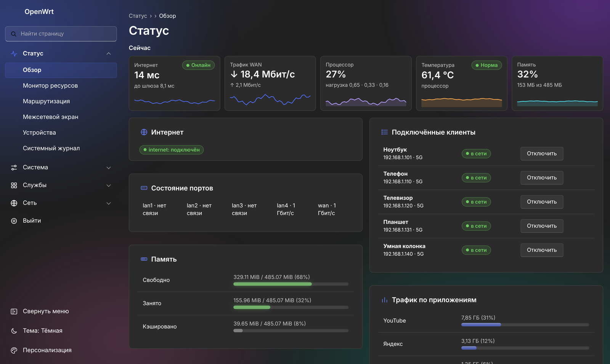
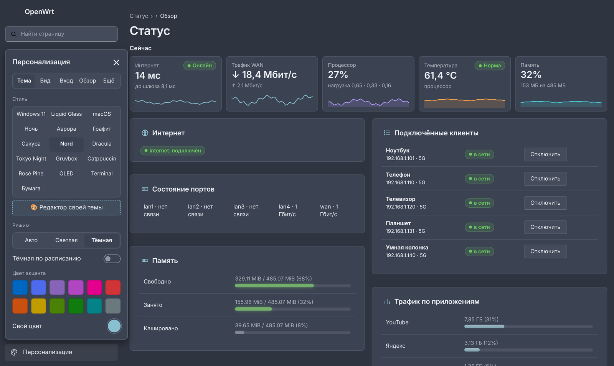
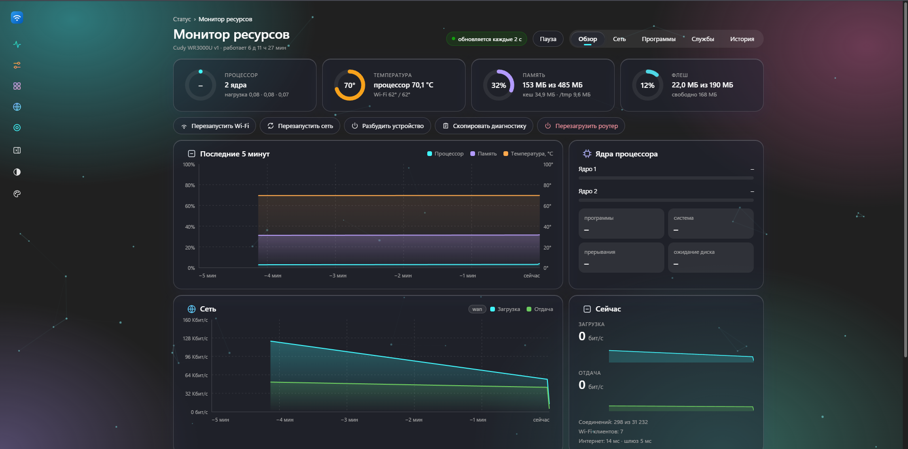
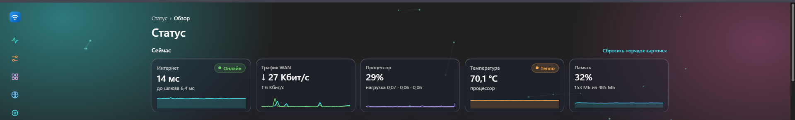
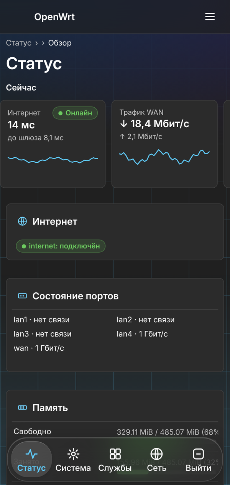
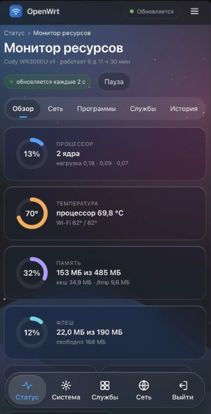
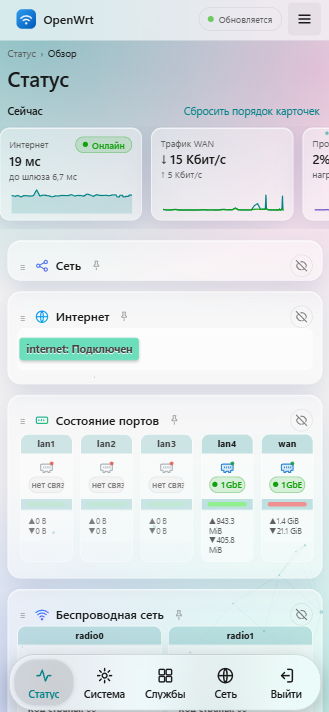

# Nightfall for OpenWrt

[Русский](README.md) | [English](README.en.md) | **简体中文** | [常见问题](FAQ.zh-CN.md)

[](https://github.com/Nikolai752/nightfall-openwrt/releases)
[](https://openwrt.org)
[](https://opensource.org/licenses/MIT)

**当前稳定版本：[Nightfall v1.30.1](https://github.com/Nikolai752/nightfall-openwrt/releases/tag/v1.30.1)。** 本版本将 `zh_Hans` 简体中文翻译扩展到界面中显示的后端消息，包括更新进度、备份与恢复输出、网络诊断、配置与设置错误、Telegram 消息、访问屏蔽原因以及 Wake-on-LAN 错误。多行备份输出会逐行翻译，机器生成的清单字段保持原样。翻译会编译为 LuCI `.lmo` 文件；安装时注册 `zh_cn`，但不会自动更改用户当前选择的界面语言。

Nightfall 是一款适用于 LuCI 的主题，提供 Windows 11 和 Liquid Glass 风格，并附带**资源监视器**页面，支持历史记录、图表、按设备和应用统计流量、Telegram 通知以及一键更新。目标平台为 **OpenWrt 25.12**。安装程序会检查 `base64`；如果系统缺少 BusyBox 对应功能，会安装用于备份的 `coreutils-base64`。更新和 Telegram 功能需要 `curl`。

> **语言说明：** Nightfall 主题和资源监视器提供俄语与简体中文（`zh_Hans`）翻译。Network、Firewall 等标准 LuCI 页面使用 LuCI 自身安装的语言包。安装 v1.30.1 后，可前往“System → System → Language and Style”选择“简体中文（Simplified Chinese）”。安装程序只注册该语言，不会自动切换当前语言。

## 截图

> **演示截图说明：** 顶部三张大图和底部左侧手机截图来自演示页面，设备、流量和数字均为虚构数据，仅用于展示主题外观。“资源监视器”“概览”以及底部右侧两张手机截图来自真实路由器。











<p align="center">
  
  
  
</p>

<p align="center"><sub>左侧为演示截图，右侧两张来自真实路由器。</sub></p>

## 功能

### 主题
- 两种风格：Windows 11（Mica、卡片）和 Liquid Glass（半透明磨砂卡片）。
- 浅色和深色模式，可跟随系统或按计划自动切换。
- 12 种强调色，也可自定义颜色。
- **一键预设主题：** Nord、Dracula、Tokyo Night、Gruvbox、Catppuccin、Rosé Pine、OLED、Terminal、Paper，以及 Night、Aurora、Graphite、Sakura。
- **动态背景：** Mica、点阵、网格、星空、极光、波浪、流光、粒子、霓虹、日落、海洋、雪、雨、一天中的时间和天气。天气背景使用 Open-Meteo 或 wttr.in，直接在浏览器中获取数据，无需 API 密钥；在某些国家/地区可能需要让设备通过 VPN 访问。另有动画星座效果。
- **图表：** 面积图、折线图、柱状图、阶梯图；10 种配色、线宽和网格设置；可根据负载显示绿/黄/红色线条，并带有流动高光和数字滚动动画。内存和存储使用条会根据占用率改变颜色。
- 页面切换动画、闪烁的“在线”指示点和按钮波纹效果；所有动画均可在“个性化”中关闭。
- “个性化”菜单分为“主题、外观、登录、概览、更多”选项卡。设置保存在路由器上，可在不同浏览器之间同步。
- 可折叠导航菜单、页面搜索（`Ctrl+K` 或 `/`）以及快速切换主题按钮。
- 移动端布局：底部导航栏、卡片式设置，以及同一行显示的“应用 / 保存 / 重置”工具栏，尺寸会适配手机屏幕。
- 类似锁屏的登录页，可显示路由器摘要；仅向本地网络客户端展示。
- 可将页面添加到手机主屏幕，作为应用使用。外观设置保存在路由器上，更换浏览器后仍然保留。
- “System → Nightfall: all elements”页面集中展示按钮、表单、表格和通知，便于在手机或电脑上检查主题样式。

### 概览
- “当前状态”区域显示互联网连接、WAN 流量、CPU、温度和内存。卡片可展开为过去一小时、一天或一周的图表。
- 卡片包括路由器状态、Wi-Fi 客户端及信号、事件流、流量排名、**应用流量**和快捷操作。卡片可拖动、固定或隐藏；宽屏下采用两列布局。
- **一键布局：**“标准”“家庭”“简洁”和“管理员”等预设，可快速切换主要状态卡片的排列。

### 资源监视器（Status → Resource Monitor）
选项卡：概览、网络、Wi-Fi、设备、程序、服务、诊断、安全、日志、历史记录。

- **Wi-Fi：** 客户端、连接质量、按小时统计的信号、无线信道占用情况和信道建议。
- **设备：** 互联网访问控制（封锁、流量限制、按星期设置计划、设备分组）以及设备流量统计。
- **概览：** 顶部显示摘要，点击后查看细节；只有进入“外观 → 编辑布局”模式时才能拖动卡片。
- **程序内存统计：** 按时间段显示程序内存使用情况，并标记可能的内存泄漏；日志条目可固定。
- **设备活动：** 显示“谁在家”和异常活动。诊断页面提供路由路径丢包、bufferbloat 测试和检查历史；网络页面会标记 WAN 地址是否属于 CGNAT。
- **增强 Wi-Fi 信息：** 对比 2.4/5 GHz 频段，提示弱信号和频繁断连，并记录客户端连接与断开事件。
- **安全设置检查：** root 密码、Wi-Fi 加密、SSH 密码登录和 LuCI HTTPS。日志可按时间范围筛选并导出 CSV；服务页面可查看各服务日志。
- **封锁可疑地址：** 安全页面可通过“封锁 24 小时”按钮封锁频繁访问的地址（使用 nft 的 `nightfall_ban` 表，规则持续到路由器重启），也可查看封锁列表并解除封锁。失败登录激增时，机器人会发送 Telegram 通知（`TG_SEC`）。
- **路由器系统日志：** 在日志选项卡中查看基于 `logread` 的日志，支持搜索和筛选。网络页面提供 **DNS 统计**（需要设置 `dhcp.@dnsmasq[0].logqueries=1`）；在设备页面点击设备行可打开详情卡片。
- **诊断：** Ping、路由跟踪、DNS、路由器测速，以及“全部检查”按钮（网关、互联网和 DNS）。
- **安全：** SSH 和 LuCI 登录成功/失败记录、频繁访问地址、路由器开放端口、端口转发、新设备和版本信息。该页面只读取路由器已有日志与设置，不会自行修改配置。
- **网络：** 接口速度、连接数、设备今日和昨日流量；点击 Wi-Fi 客户端行可查看信号强度图表。
- **历史记录：** 提供 1 小时、24 小时和 7 天图表、连接质量、断网与重启日志，以及告警和通知设置。
- **服务：** 查看路由器服务状态并启动、停止或重启服务。已启用自启动但当前未运行的服务会标红。为避免失去访问权限，不能从此页面停止网络、Web 服务器、SSH 和防火墙等关键服务。
- 路由器可使用多线程测试互联网速度，支持 Cloudflare、Yandex Mirror、Hetzner、OVH 或自定义地址，可手动或按计划运行。
- 即使页面关闭，也可收到过热、内存不足、闪存空间不足、负载过高、互联网中断和新设备接入等提醒。

### 按应用统计流量
- 查看 YouTube、Telegram、Netflix、Google、Yandex 等服务今天、最近 7 天、最近 30 天或累计的流量，也可按设备查看。
- 可对比不同时间段，并将流量、应用、图表和日志导出为 CSV。

### Telegram 通知和机器人
- 可通知互联网断开/恢复、过热、内存不足、路由器重启和新设备接入。机器人提供状态、客户端、流量、设备封锁、重启等按钮，并支持每日报告。
- **设备与分组**（Status → Devices）：网络拓扑图以路由器为中心显示设备；Wi-Fi 连接使用虚线，有线连接使用实线，传输数据时线路会动态显示速度。点击设备可打开详情卡片，其中包括自定义名称、图标、分组、今日及实时流量、Wi-Fi 信号、互联网访问控制、计划和每日限额。
- **分组管理：** 可创建“儿童”“访客”“智能家居”等分组。分组规则会同时应用于所有成员，包括断网、时间计划和每日流量限额。也可通过 Telegram 机器人管理分组。
- **互联网访问控制：** 可在概览卡片或机器人中手动断开某个设备的互联网，也可按星期和多个时间段设置计划，或按每日流量限额自动断网。封锁仅限制该 MAC 地址访问互联网（独立的 nft `inet nightfall` 表），路由器本身和局域网仍可访问。使用随机 Wi-Fi 地址的手机，最好在手机自身设置中管理。
- **登录页面：** 可在“个性化 → 登录页面”选择信息卡片，显示互联网状态、当前速度、测速、运行时间、固件、温度、负载、内存和设备数量。也可上传自定义图片替代 Logo。摘要只在局域网内显示。
- **备份：** 机器人可创建经过验证的本地归档并发送到 Telegram；归档也保留在路由器存储中。LuCI 页面可创建备份；可通过 Telegram 机器人或 SSH 获取文件并安全恢复。备份不包含 Telegram 密钥和 OpenWrt 网络设置。
- **界面更新：** 提示有新版本时，可一键安装；安装前检查 SHA-256 和签名，失败时回滚，重新登录后显示更新日志。

当前采集数据存放在 RAM（`/tmp`）。若要在重启后保留历史记录，请将 `PERSIST_DIR` 设置为 USB/SD 存储路径。Nightfall 会保存详细数据、最长 90 天的长期历史、每小时 Wi-Fi 信号和按小时流量。备份会自动放在同一外置存储分区中的独立 `nightfall-backups` 目录。如果存储设备未挂载，历史记录写入会暂停，不会退回到底层 `/overlay`；备份则临时写入 `/tmp`。

### 低性能路由器的 Lite 模式
在“资源监视器 → 设置”中调整 `LITE`。默认 `LITE=0` 为完整模式：采集器每 15 秒轮询一次，并启用应用流量统计和 Wi-Fi 历史。设置 `LITE=1` 后，采集间隔变为 60 秒，并关闭应用流量统计和 Wi-Fi 历史，从而降低 CPU 和 RAM 占用。监视器标题栏和“路由器状态”卡片会显示实际运行模式，而不只是配置文件中保存的值。

### 应用流量统计的工作方式
概览页面的“应用流量”卡片显示 YouTube、Telegram、Netflix 等服务的流量，可按今天、7 天、30 天、累计或设备查看。“其他”项目下方还会列出流量较大的未识别域名。

点击卡片中的按钮即可启用。Nightfall 会打开 dnsmasq DNS 日志（保存在 RAM 中的 `/tmp/nightfall-dns.log`，最大 1 MB）和 conntrack 计数器，并将连接地址与 DNS 请求中的域名匹配。关闭功能后会恢复 dnsmasq 之前的设置。内置规则位于 `/usr/share/nightfall/apps.list`；自定义规则可写入 `/etc/nightfall-apps.list`，格式为 `名称|空格分隔的域名|IP 前缀`，自定义规则优先检查。

限制：无法准确识别通过 VPN 或加密 DNS（DoH/DoT）的流量；启用 Flow Offloading 时计数可能偏低，因此应用归类结果为近似值。

### Telegram 通知与机器人设置
监视器可通过 Telegram 通知互联网断开或恢复、过热、内存不足、路由器重启，以及未知设备接入。每小时最多发送 30 条通知。

**设置步骤：**
1. 在 Telegram 中通过 @BotFather 创建机器人（`/newbot`），并复制 Token。
2. 打开自己的机器人并点击 Start。
3. 在设置中点击“检测 chat id”，然后点击“发送测试”。
4. 开启“发送通知”并保存。

**按钮机器人：** 在私人聊天中，机器人响应配置的所有者（`TG_CHAT`）；管理操作仅管理员可用。发送 `/menu` 打开菜单：状态、客户端、流量、应用、测速、封锁、访客 Wi-Fi、唤醒设备（Wake-on-LAN）、备份、服务、重启、清理聊天和更新。封锁菜单还提供设备分组和封锁日志。重启服务和路由器需要单独确认。常用命令：`/menu`、`/help`、`/status`、`/clients`、`/traffic`、`/apps`、`/speed`、`/block`、`/wake`、`/guest`、`/svc`、`/restart`、`/report`、`/update`、`/widget`。设置 `TG_BOT=0` 可关闭机器人。

**备份与恢复：** 点击“备份”后，机器人会创建经过验证的归档，在路由器上保留本地副本，并将归档作为单独文件发送到 Telegram。点击文件下方的“检查并恢复”，机器人会验证归档并显示内容；随后才会显示“恢复设置”确认按钮（有效期 5 分钟）和“取消”按钮。恢复成功后，机器人会报告结果并重启采集器和自身。归档不包含 OpenWrt 网络设置；`TG_TOKEN` 和 `TG_PROXY` 不会写入归档，恢复时会保留路由器当前配置中的值。不要将归档手动解压到 `/` 或 `/etc`。详见[备份与恢复指南（俄文）](docs/backup-restore.md)。

**每日报告：** 在设置中指定“每日报告时间”（例如 `21:00`），机器人会发送当天流量、设备和应用排名、告警及最高温度。留空表示关闭。

需要 **curl**（`apk add curl`）。如果 `api.telegram.org` 无法访问，可设置 Telegram 代理（例如 `socks5h://127.0.0.1:1080`）或 VPN 接口（例如 `wg0`），Telegram 请求将通过它们发送。已知设备保存在 `/etc/nightfall-known.list`；使用随机 Wi-Fi 地址的手机可能被识别为新设备。机器人 Token 保存在 `/etc/nightfall-monitor.conf`（权限 600），不会显示在界面中。

## 支持项目

如果 Nightfall 对你有帮助，可以请作者喝杯茶。完全自愿，不会影响任何功能。

[](https://pay.cloudtips.ru/p/7e7fa6da)

## 安装

需要能够通过 SSH 访问路由器。

**一条命令安装**（路由器需要能够访问互联网）：

```sh
wget -qO- https://raw.githubusercontent.com/Nikolai752/nightfall-openwrt/main/install-update.sh | sh
```

脚本会自动查找最新版本、下载发布归档、验证校验和与签名，并在结束时显示已安装版本。如果 `wget` 无法处理 HTTPS，可使用 `curl -fsSL URL | sh`（安装 `apk add curl ca-bundle`）。

参数放在 `sh -s --` 后面，例如 `... | sh -s -- --activate`：

| 参数 | 说明 |
| --- | --- |
| `--activate` | 安装后立即将 Nightfall 设为默认主题 |
| `--check` | 仅显示已安装版本和最新版本 |
| `--force` | 即使已经是最新版本也重新安装 |
| `--list` | 列出最近的版本 |
| `--version vX.Y.Z` | 安装指定的已发布版本（包括旧版本） |
| `--file PATH` | 从本地归档安装 |

**路由器无法联网时手动安装：** 从 [Releases](https://github.com/Nikolai752/nightfall-openwrt/releases/latest) 下载 `nightfall-root.tar.gz` 和 `install-update.sh`，将它们放在同一目录，然后执行：

```sh
scp -O nightfall-root.tar.gz install-update.sh root@192.168.1.1:/tmp/
ssh root@192.168.1.1 "cd /tmp && sh install-update.sh --activate"
```

如果没有使用 `--activate`，请在 System → System → Language and Style 中选择 Nightfall。通过网络安装时，不会使用遗留在 `/tmp` 中的旧归档。

安装后退出 LuCI 并重新登录，然后按 `Ctrl+F5`。iPhone 用户请关闭主屏幕上的 Nightfall 应用后重新打开。

## 更新

更新时使用与安装相同的命令。现有设置会保留。如果已经是最新版本，脚本会提示无需更新；使用 `--force` 可重新安装。

### 从界面更新

发布新版本后，主题会显示“有新版本可用”提示。点击“更新”，路由器会下载发布归档、检查 SHA-256 校验和及签名；发生错误时会从备份恢复原文件。自 v1.0.11 起，发布归档还使用 usign 签名，路由器会通过 `/etc/nightfall-release.pub` 中的公钥验证签名。第一次升级到带签名的版本（v1.0.11）时会先通过 SHA-256 安装并获取公钥；之后始终要求签名有效。更新后会重新启动会话；再次登录后，可查看来自 `CHANGELOG.md` 的“更新内容”提示。

路由器需要 **curl** 下载发布归档（`apk add curl`；较旧版本可用 `opkg install curl`），并需要 **usign** 验证签名（OpenWrt 25.12 已包含）。

## 卸载

通过 SSH 在路由器上执行：

```sh
wget -qO- https://raw.githubusercontent.com/Nikolai752/nightfall-openwrt/main/uninstall.sh | sh
```

脚本会切换回默认主题，并移除 Nightfall 主题、资源监视器、机器人、历史采集器、菜单项、rpcd 权限、LuCI 设置和缓存。默认保留 `/etc/nightfall-*` 中的设置，以便以后重新安装时恢复。参数（放在 `sh -s --` 后）：

- `--wipe`：删除所有内容，包括设置、设备列表、日志和机器人 Token。
- `--theme-only`：仅切换回默认主题，不删除文件。

如果 LuCI 完全无法打开，可执行：

```sh
uci set luci.main.mediaurlbase=/luci-static/bootstrap
uci commit luci
```

## 配置

- **主题外观：** 点击左下角的“个性化”按钮。颜色和尺寸变量位于 `cascade.css` 文件开头（`--nf-accent`、`--nf-bg`、`--nf-radius`）。
- **告警、互联网检查地址和历史目录：** 资源监视器 → 历史记录 → 告警设置，或编辑 `/etc/nightfall-monitor.conf`。
- **采集器服务：** `/etc/init.d/nightfall-collector start|stop|restart|enable|disable`。停止该服务后，历史记录、流量统计和 Telegram 机器人都无法正常工作（机器人由同一服务启动）。
- **设备流量统计：** 需要 `net.netfilter.nf_conntrack_acct=1`。可执行 `echo "net.netfilter.nf_conntrack_acct=1" >> /etc/sysctl.conf && sysctl -p`。启用 Flow Offloading 后，部分流量可能无法统计，数值可能偏低。
- **唤醒设备：** 需要安装 `etherwake`。如果不显示温度，请提供命令 `ls /sys/class/thermal/*/type /sys/class/hwmon/*/name` 的输出。

## 系统要求与兼容性

- **目标平台：OpenWrt 25.12 + LuCI。** v1.30.1 已通过 CI 功能测试和浏览器 smoke 测试。项目主要硬件测试参考为 **Cudy WR3000U-256MB 1.0（WR3000U v1）+ OpenWrt 25.12.6**；列出的硬件场景是在此前测试版本中使用该设备验证的，这不代表 v1.30.1 的每项功能都已在实体路由器上单独认证。OpenWrt 23.05 和 24.10 的 LuCI 模板及菜单可能不同，尚未确认兼容性；OpenWrt 21.02 及更早版本不受支持。
- **CPU 架构不受限制：** 主题不包含编译后的程序，主要由 CSS、JavaScript、模板和 Shell 脚本组成。
- **存储空间：** 安装后的主题约占 1.4 MB。对于只有 4–8 MB 闪存的路由器，这可能较多；16 MB 及以上通常更合适。如空间不足，可删除 iPhone 启动画面目录 `/www/luci-static/nightfall/splash`。
- **RAM：** 历史数据保存在 `/tmp`。对于 RAM 不超过 64 MB 的路由器，占用可能比较明显。
- **温度：** 从 `/sys/class/thermal` 和 `/sys/class/hwmon` 读取。如果设备没有相应传感器，则不会显示温度，其他功能不受影响。
- **设备流量统计：** 需要 `nf_conntrack`（见“配置”）。

## 测试状态

**主要硬件测试参考：** Cudy WR3000U-256MB 1.0（WR3000U v1），运行 OpenWrt 25.12.6。此前测试版本曾在该设备上检查采集器、Telegram 机器人、通知、设备和应用统计、USB 历史持久化以及备份创建与恢复。这不代表 v1.30.1 的每项功能、第三方 LuCI 页面或附加软件包（例如 adblock、sqm）都在该路由器上单独测试过。Nightfall 并不局限于 Cudy 设备，但其他路由器型号的硬件测试结果尚未确认。

如果你在其他路由器上安装了主题，欢迎在 [Issues](https://github.com/Nikolai752/nightfall-openwrt/issues) 中反馈型号、OpenWrt 版本以及哪些功能正常或异常。这有助于建立经过测试的设备清单。发现问题或希望改进，也请提交 Issue。

## 仓库结构

- `luci-theme-nightfall/`：主题 CSS、JavaScript 和模板。
- `luci-app-nightfall-monitor/`：资源监视器、历史采集器、应用流量统计、Telegram 机器人、更新程序、菜单和访问权限。
- `CHANGELOG.md`：版本更新记录（更新后显示）。
- `install-update.sh`（安装和更新）、`install.sh`（包装脚本）、`uninstall.sh`：安装、更新和卸载。
- `build-release.sh`：生成 `dist/nightfall-root.tar.gz`。

## 发布新版本

发布包使用 [usign](https://git.openwrt.org/project/usign.git) 密钥签名。只需创建一次密钥，可在任意路由器上执行：

```sh
usign -G -c "Nightfall release key" -s nf.sec -p nf.pub
```

将 `nf.pub` 的内容放入 `luci-theme-nightfall/root/etc/nightfall-release.pub`，将 `nf.sec` 的内容保存为仓库 Secret：`NIGHTFALL_SIGN_KEY`（Settings → Secrets and variables → Actions）。

主题版本保存在 `luci-theme-nightfall/htdocs/luci-static/nightfall/version.json`（“关于”页面也会显示该版本）。发布前应使其与 `CHANGELOG.md` 顶部版本号一致；`tools/check.sh` 会检查这一点。资源缓存版本（`header.ut` 中的 `?v=…`）无需手动修改，`build-release.sh` 会自动写入发布版本号。

然后创建形如 `vX.Y.Z` 的标签并发布。GitHub Actions 会构建 `nightfall-root.tar.gz`、签名并附加 `.sha256` 和 `.sig` 文件，同时更新 `latest.json)。不要忘记在 `CHANGELOG.md` 中添加版本记录。

源码树中已经包含主题变体和配置文件所需的标准符号链接。打包程序会在暂存时保留这些链接、验证其目标，只创建缺失的链接；若路径存在冲突则停止，不会覆盖现有内容。**签名 TAR.GZ 是官方支持的主要发布和更新格式；APK 仅供手动安装，不会由标准安装程序或更新程序使用。**
